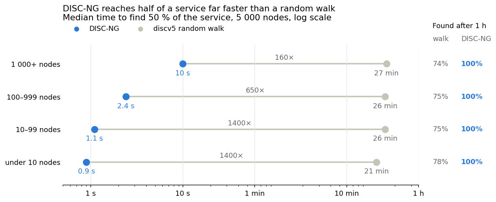
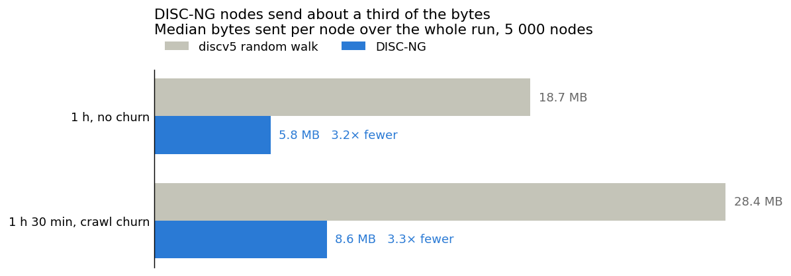
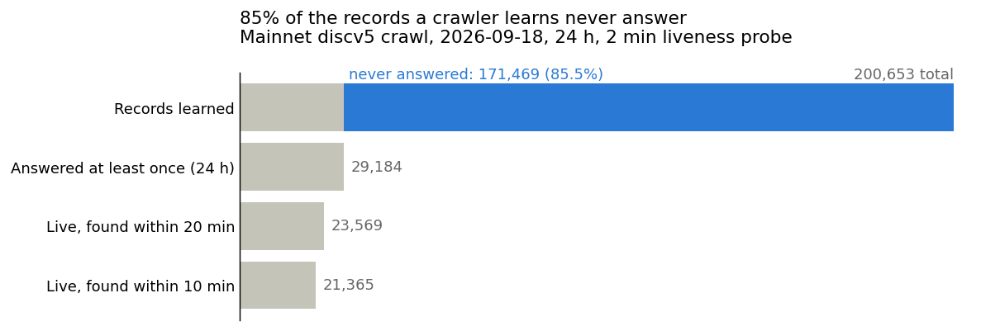

# DISC-NG against discv5: what discovery costs

A common objection to DISC-NG is that consensus networks don't need it: plain discv5 already finds peers, and the cost is small once a node is up. This document compares DISC-NG with legacy discv5 on the same simulated network of 5 000 nodes, and adds what crawling costs on the real discv5 network.

At 5 000 nodes, DISC-NG found every provider of its service within seconds and sent 3.2 times fewer bytes per node than plain discv5. The discv5 random walk found about 75 % of each service after an hour. Crawling instead covers the network, but a mainnet crawler needs about 290 pings per second just to keep its view current.

## 1. The question

The objection makes two predictions we can check:

1. A plain discv5 node finds the providers of its service about as well as a DISC-NG node.
2. It does so at a similar cost per node.

## 2. Setup

Every run uses the same simulated network, the same services and the same seed. Only the way a node finds the providers of its service changes. Every node runs the discv5 code of geth (fork below); the random walk is geth's own `Lookup` to random targets, repeated for the whole search.

| Method | How a node finds providers | Advertising |
|---|---|---|
| DISC-NG (TopDisc) | Topic search on registrars near the service hash; adaptive distance, floor 8 | Registers ads on registrars, plus the service entry in its node record |
| discv5 random walk | Random-target Kademlia lookups for the whole search, keeping nodes whose record names its service | Service entry in its node record |

| Parameter | Value |
|---|---|
| Simulator | simnet (in-process discv5 nodes), 30 ms per link, no loss |
| Network size | 5 000 nodes |
| Services | the 100 largest chains of the 2026-09-18 discv5 crawl, with their crawl shares; addresses drawn from the crawl |
| Search | every node searches its own service, continuously, for 1 h; 3 min boot, 15 min start window, 15 min wait |
| "Found" | share of the nodes of its service a searcher has learned |
| Churn | none, except the 5k churn pair, which replays per-chain sessions from the crawl |

The runs come from [topdisc-vs-discv5.md](topdisc-vs-discv5.md).

## 3. DISC-NG against the discv5 random walk (5 000 nodes)

DISC-NG found every provider in seconds and sent a third of the bytes. The random walk found about 75 % of each service in an hour, whatever the service size.

*Source: [topdisc-vs-discv5.md](topdisc-vs-discv5.md). 5 000 nodes, 1 h search, medians over searchers.*

*Source: [topdisc-vs-discv5.md](topdisc-vs-discv5.md). 5 000 nodes, medians over all nodes.*

The gap also holds at the tail. Without churn, the 95th percentile was 17.9 MB for DISC-NG nodes and 27.8 MB for walk nodes.

- The walk does the same work for every service. Each lookup covers one part of the ID space, so a small service is found only by chance. Services under 10 nodes took 3.8 min to their first result.
- With churn, DISC-NG kept the same times and found 99.9 to 100 % of each service.
- In mixed networks with as few as 10 % DISC-NG nodes, those nodes still found all DISC-NG nodes of their service in about 12 s.

## 4. Why not crawl instead

A plain discv5 node could crawl the network instead of walking it. A 24 h crawl of mainnet discv5 found 85 % of the eventual live nodes within 10 minutes. After that it needed about 290 pings per second just to keep its view current, and most of the records it learned pointed to nodes that never answered.

*Source: [crawl-2026-09-18.md](crawl-2026-09-18.md), 24 h mainnet crawl.*

At steady state the crawler sent about 241 pings per second to known nodes and another 46 to records that never answered. It saw 50 to 100 new nodes every 10 minutes. It marked a node as gone after 3 missed pings over at least 2 probe periods, about 4 to 6 minutes. Of 19.75 M pings, 8.7 % timed out.

- Most of the crawler's work goes to dead records. A DHT keeps many stale entries, so a crawl spends most of its effort on nodes that are gone. A simulator without stale records does not show this.
- Bytes were not logged. At about 250 B per ping and pong, 290 pings per second comes to roughly 260 MB per hour for one crawler. This is an estimate.
- The crawler's FINDNODE traffic for finding new nodes was not counted, so these figures are a lower bound.
- If every node crawled with a 2 min probe, each node would receive one ping per crawler every 2 minutes: about 210 requests per second per node at 25 000 nodes. Total load grows with the square of the network size.

## 5. Conclusion

Both predictions fail at 5 000 nodes.

1. Plain discv5 does not find a service as well. The random walk found about 75 % of each service after an hour and took 21 to 27 min to reach half of it. DISC-NG found 100 % and reached half in 0.9 to 10 s.
2. Plain discv5 costs more. Walk nodes sent 18.7 MB each over the run, against 5.8 MB for DISC-NG nodes: 3.2 times more. With churn the gap stayed the same, 28.4 MB against 8.6 MB.
3. Crawling does not close the gap cheaply. A crawl covers the network in minutes, but on mainnet it then needs about 290 pings per second, and 85 % of the records it learns never answer.

DISC-NG also works when only part of the network runs it: with 10 % DISC-NG nodes, those nodes found all DISC-NG nodes of their service in about 12 s.

## 6. Limits

- One run per scenario, one seed, in simnet: no packet loss, no stale records, 30 ms per link.
- 5 000 nodes for 1 h. Mainnet discv5 has about 23 500 live nodes. The walk's coverage at that size was not measured.
- The walk searches for the whole hour. Real geth stops once its peer slots (about 50) are full, so it finds less of its service than this walk. That case was not measured.
- In simnet a walk lookup took about 8.4 s (428 lookups per node per hour). Part of that may be the simulator's own throughput limit, so the walk's bytes and times depend on how fast the host is.
- The mainnet crawl's bytes are estimates, and its FINDNODE traffic was not counted.

## Sources

- [topdisc-vs-discv5.md](topdisc-vs-discv5.md): 5k random-walk and DISC-NG runs, churn and mixed networks
- [crawl-2026-09-18.md](crawl-2026-09-18.md): mainnet crawl, 24 h, 2 min probe
- `cmd/simnet/legacy_search.go`: the random-walk search; scenarios `simnet-crawl-5k-discv5.yaml` and `simnet-crawl-5k-topdisc.yaml`
- [datahop/go-ethereum](https://github.com/datahop/go-ethereum) `v1.17.2-testbed.13`: the discv5 and DISC-NG implementation used in the simulated runs
- Figures: `figures/discng_vs_discv5.py`
