# TopDisc (DISC-NG): final evaluation report

2026-10-27 · datahop/go-ethereum `topdisc`, fork `v1.17.2-testbed.23` · datahop/topdisc-testbed · companion: [the same workload without churn, Grid'5000](no-churn/)

## Summary

On 25,000 nodes with churn replayed from the mainnet crawl analysis, TopDisc found a median 99.5 % of each topic's providers; plain discv5 found 71.3 %.

- TopDisc reached half of a topic's providers in 87 s and 90 % in 17.8 min. discv5 needed 36.4 min for half and never reached 90 %.
- 92.9 % of TopDisc searchers found at least 90 % of their providers, against 0.3 % of discv5 searchers.
- Every topic size gains. Topics under 100 nodes are found in seconds: 90 % in 7.6 s for 10 to 99 nodes and 2.9 s under 10.
- The busiest registrar received 10.2× the median topic-query load, just above the 10× limit the checks set.
- The median TopDisc node sends 24 % fewer bytes than a discv5 node (25 vs 33 MB); the 95th percentile sends 45 % more (100 vs 69 MB), because registrars of popular topics serve the replies.

## Scenario and setup

The two runs are a pair: the same workload, seed and churn schedule, with only the protocol changed. discv5 nodes run plain discv5 built from the same fork, so both sides share the networking code and the counters.

- **Network.** 25,000 nodes on 50 AWS m6a.2xlarge hosts, 500 per host, each node in its own network namespace with a 1 Mbit/s link, 4 to 45 ms one-way delay and 3 ms jitter.
- **Topics.** The 100 largest chains of a 24 h crawl of the discv5 mainnet, each topic sized by its chain's share in the crawl. The two largest hold 29 % and 22 % of nodes; the smallest has 4. Every node registers and searches one topic.
- **Churn.** Node sessions replayed from the same crawl ([churn analysis](../churn-analysis.md); [on GitHub](https://github.com/datahop/topdisc-testbed/blob/main/docs/churn-analysis.md)): 42 % of nodes stay up throughout, and the rest leave and rejoin with the session lengths measured on mainnet, about 8,200 departures over the run.
- **Phases.** 3 min bootstrap, registration from +3 min with starts spread over 15 min, then one continuous 90 min search per node from +33 min.
- **TopDisc parameters.** Ad lifetime 15 min, ad cache 5,000, 10 registrars per registration bucket, 16 ads per reply, 8 referrals per reply, yield floor 8, at most 32 queries per search pass, result mixing across 5 registrars.

**Metrics.** Recall is the median, over searchers, of the share of a topic's providers found, counting only providers still up at the end of the search. "Time to 50 %" and "time to 90 %" are medians over searchers of when they reached that share. Load is TOPICQUERY requests received per node, with the bootnode reported apart.

**Checks.** 34 automatic checks score each run: ad cache bounds, admission timing, bucket limits, result correctness, message accounting, registrar load and host health.

The sections below are generated by the testbed's paired report.


## Runs and parameters

| label | protocol | lookup model | nodes | topics | search phase | run directory |
|---|---|---|---:|---:|---:|---|
| TopDisc | TopDisc | continuous | 25,000 | 100 | 90.0 min | `slim-topdisc` |
| discv5 | plain discv5 | continuous | 25,000 | 100 | 90.0 min | `slim-discv5` |

### Parameters

Both runs use the same values; only the protocol differs. Topic values marked *fork default* are the implementation's defaults (fork `v1.17.2-testbed.23`); the scenario left them unset.

| Parameter | Value | What it sets |
|---|---|---|
| Nodes | 25,000 | 50 AWS m6a.2xlarge hosts, 500 nodes per host |
| Topics | 100 | the 100 largest chains of the 2026-09-18 mainnet crawl; every node registers and searches one |
| Topic popularity | crawl chain shares (`crawl-2026-09-18.json`) | each topic's share of nodes is its chain's share in the crawl |
| Seed | 1 | topic assignment, placement and churn schedule; same in both runs |
| Link | 1 Mbit/s, 4–45 ms one-way delay, 3 ms jitter | per node, in its own network namespace |
| Regions | ap-southeast-1 30 %, eu-central-1 30 %, us-east-1 40 % | delay between nodes follows the region RTT table |
| Churn | session churn from the crawl, 42.3 % always on, 24 h of crawl over the run | the other nodes leave and rejoin with the session lengths measured per topic |
| Bootstrap | 3 min | nodes fill their routing tables before registering |
| Registration start | spread over 15 min, search starts 15 min after | avoids synchronised registrations and expiries |
| Search | continuous, 90 min, one search per node | the search keeps running and reports every provider it finds |
| Ad lifetime | 15 min (fork default) | how long a registrar keeps an ad |
| Ad cache | 5,000 ads | per registrar |
| Registration attempt budget | 1.5 × ad lifetime (fork default) | an advertiser drops a registrar whose waits add up to more |
| Registration table | 18 buckets × 10 registrars, 20 standby (fork default) | `K_register` = 10 |
| Search table | 18 buckets × 8 (fork default) | one registrar per /24 per bucket |
| Ads per reply (`F_return`) | 16 (fork default) | |
| Referrals per reply | 8 (fork default) | registrars at the requested distances |
| Search yield floor | 8 | ads per reply below which the search moves inward |
| Referral radius | 1 bucket (fork default) | referrals asked for only around the active bucket |

### Topic assignment

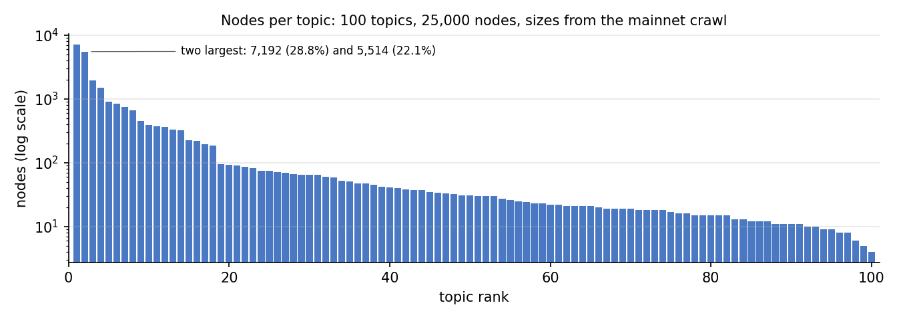

**Reading.** The 100 topics follow the mainnet crawl: the two largest hold 28.8 % and 22.1 % of the 24,990 traced nodes and the smallest has 4. One run tests very popular and very rare topics together.

| Topic size | Topics | Nodes | Share of nodes |
|---|---:|---:|---:|
| 1,000+ | 4 | 16,149 | 64.6% |
| 100–999 | 14 | 6,219 | 24.9% |
| 10–99 | 75 | 2,573 | 10.3% |
| under 10 | 7 | 49 | 0.2% |

Classes here count assigned nodes. The result tables below group topics by registrants, so a few small topics fall one class lower there.

## Correctness checks

`checks.py` on each run. *n/a*: a TopDisc check on the plain discv5 run; *not-exercised*: the run never reached the condition; *needs-data*: the traces lack a field the check needs.

| check | assertion | TopDisc | discv5 |
|---|---|---|---|
| **C1** registration | capacity: ads held never exceed the cache size | pass | n/a |
| **C2** registration | no duplicates: one ad per advertiser and topic per registrar | pass | n/a |
| **C3** registration | only registrants: every held ad is from a node registering that topic | pass | n/a |
| **C4** registration | only capable nodes: no legacy node in any cache | not-exercised | n/a |
| **C5** registration | no self-ads: a registrar never holds its own ad | pass | n/a |
| **K1** registration | departed nodes leave caches within an ad lifetime | pass | n/a |
| **E1** registration | lifetime: expired ads are swept promptly and no ad expires beyond a lifetime | pass | n/a |
| **E2** registration | renewal keeps fan-out: final fan-out against the post-register level | pass | n/a |
| **E3** registration | renewal accounting: renewals received match renewals sent beyond session setups | not-exercised | n/a |
| **W1** registration | bounded wait: every admission within 2 % of the attempt timeout | pass | n/a |
| **W2** registration | no early admission: admitted only after the required wait | **fail** | n/a |
| **W3** registration | lower bound: a repeated quote never undercuts the previous one by more than the time elapsed | **fail** | n/a |
| **W4** registration | full cache admits nothing | not-exercised | n/a |
| **W5** registration | ticket validity: early, late, wrong-topic and bad-MAC tickets rejected | unit-test | n/a |
| **W6** registration | record address: admitted record IP equals the packet source | pass | n/a |
| **R1** registration | bucket size: registered plus waiting never exceed the bucket size | pass | n/a |
| **R2** registration | bucket IP diversity: one registrar per /24 per bucket | not-exercised | n/a |
| **R3** registration | state maintained: tables complete by search start and no bucket left empty with candidates | pass | n/a |
| **L1** search | right topic: every result registers the requested topic | pass | pass |
| **L2** search | capable results: no legacy node among results | not-exercised | not-exercised |
| **L3** search | no expired results: no result down longer than a lifetime | pass | n/a |
| **L4** search | termination: lookups end at the target or the timeout, hit flag consistent | pass | pass |
| **L5** search | reply limits: nodes per reply within the topic and aux limits | pass | n/a |
| **L6** search | no duplicate results within a lookup | pass | pass |
| **I1** search | no topic messages to legacy peers | not-exercised | n/a |
| **I2** search | base discovery: legacy nodes still find providers | not-exercised | **fail** |
| **A1** load | request accounting: REGTOPIC and TOPICQUERY sent equal received | pass | n/a |
| **A2** load | every query answered: TOPICNODES sent at least TOPICQUERY received per node | pass | pass |
| **A3** load | registrar load bound: busiest registrar within a multiple of the median | **fail** | n/a |
| **H1** load | no packet drops on any host | **fail** | **fail** |
| **H2** load | complete collection: a trace for every node | **fail** | pass |
| **H3** load | hosts under load: node CPU and host memory within limits | pass | pass |

Failures:

- **W2** TopDisc: 17 of 16347843 admissions before the required wait
- **W3** TopDisc: 95 of 17667052 repeated quotes undercut the lower bound
- **I2** discv5: 81 of 23170 legacy nodes found nothing, 1830 online under 5 min of their search skipped
- **A3** TopDisc: busiest registrar at 10.2× the median, above 10.0×; bootnode 0 left out: 45692 queries, 5.2× the median
- **H1** TopDisc: 1192568 packet drops: netem 251796, namespace UDP receive buffer 887, ARP 0, ENA allowance 939885 (bw_out 939885), host UDP receive buffer 0; veth 0; longest egress queue 428 kB (3.4 s at 1000 kbit/s)
- **H1** discv5: 879268 packet drops: netem 1394, namespace UDP receive buffer 0, ARP 0, ENA allowance 877874 (bw_out 877874), host UDP receive buffer 0; veth 0; longest egress queue 340 kB (2.7 s at 1000 kbit/s)
- **H2** TopDisc: 10 of 25000 traces missing

## 1. Registration and cache (TopDisc only)

Plain discv5 nodes publish their service in their node record and register nothing, so this section has one run.

### 06_fanout_both_views

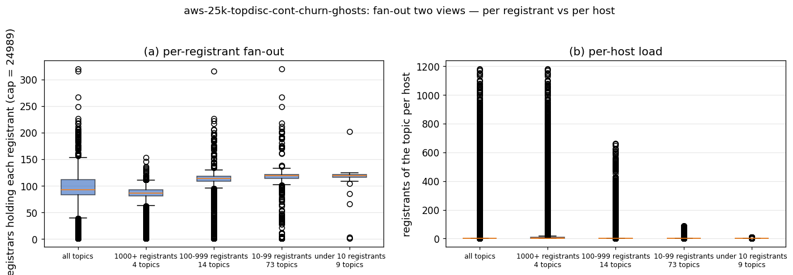

*(a) Registrars holding each registrant's ad; (b) ads held per registrar.*

**Reading.** The median registrant is held by 93 registrars, so most ads reach many registrars. Under churn, 5.9 % of registrants fall below half that and 4.4 % below 10, and (b) reaches about 1,180 registrants per host for the largest topics.

*Churn adds the outliers in (a). Under churn, 5.9 % of registrants sit below half the median fan-out of 93 (4.4 % under 10 registrars) and 0.3 % above 1.5× the median, up to 320. The same workload without churn (Grid’5000) has none outside the box: fan-out runs from 34 to 50 around a median of 43, with no registrant below half the median.*

### 04_id_space_registrants

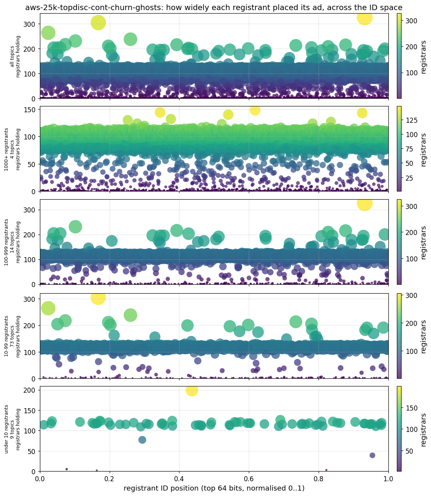

*Fan-out of each registrant across the ID space.*

**Reading.** Fan-out is flat across the ID space, about 85 to 120 registrars in every size class, so placement does not depend on a registrant's ID. A minority of registrants sit near zero in every class, the churn outliers of 06_fanout.

### 04b_id_space_registrars

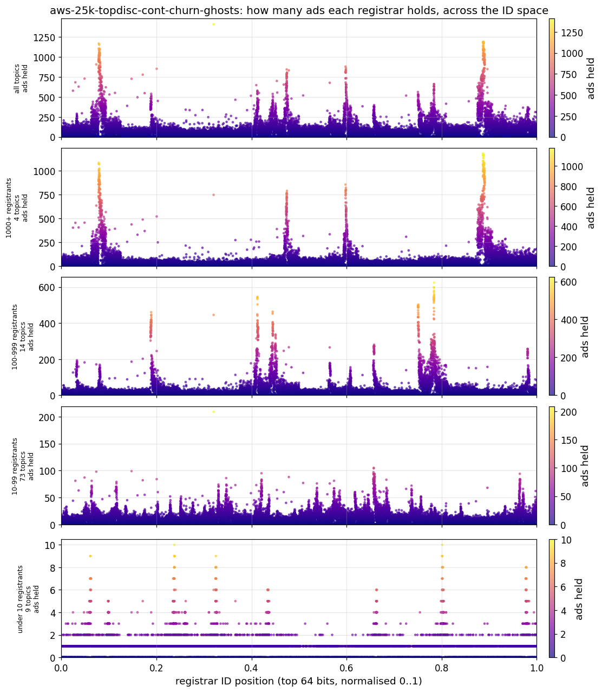

*Ads held by each registrar across the ID space.*

**Reading.** Most registrars hold under 250 ads, but registrars beside the two largest topic IDs hold up to about 1,200. Load concentrates near popular topic IDs, although every cache stays far below its 5,000-ad capacity.

### Cache occupancy across the ID space

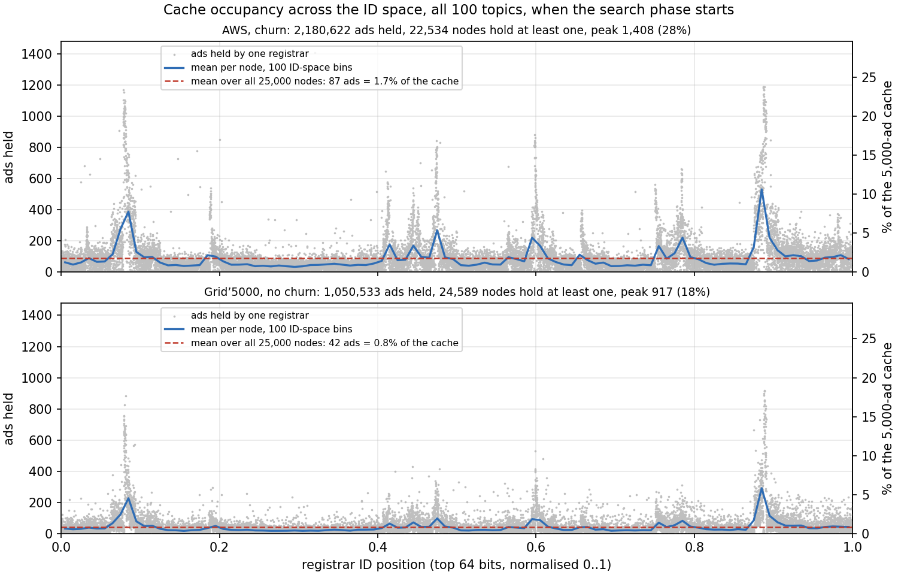

*Ads held per registrar over all topics when the search phase starts, with the mean per node in 100 ID-space slices and the mean over all nodes, as a share of the 5,000-ad cache.*

**Reading.** Registrars hold 87 ads on average, 1.7 % of the cache, so capacity is never a limit. Occupancy is uneven: it peaks near popular topic IDs, at 1,188 ads (24 %) beside the largest topic.

### 07_registration_latency_bar

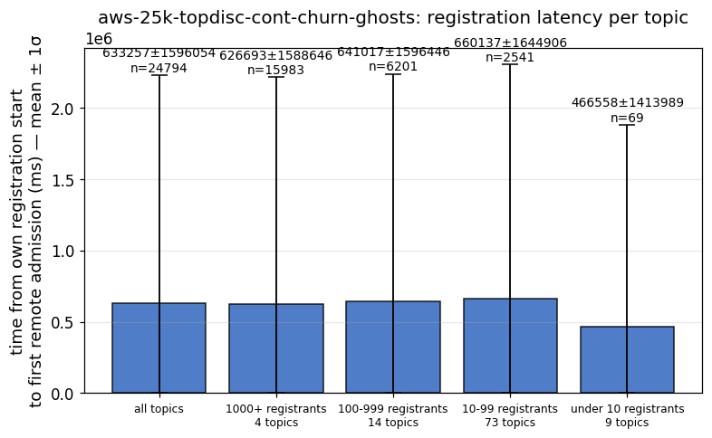

*Mean ± 1σ time to first remote admission per topic.*

**Reading.** Mean time to first remote admission is about 630 to 660 s with a standard deviation near 1,600 s in classes of 10 or more registrants, and 467 s under 10. A long tail pulls the mean up; the median is 0.8 s.

### 07_placement_time_idspace

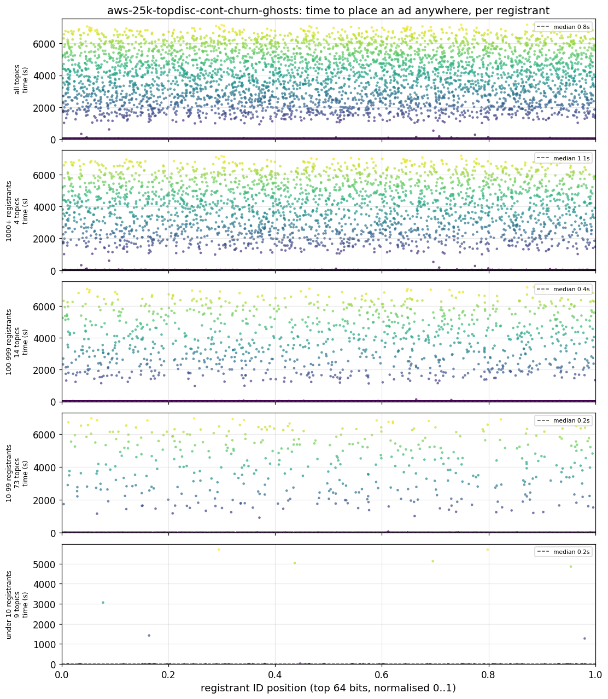

*Time to first admission across the ID space (earliest registrar).*

**Reading.** Median time to place an ad is 0.8 s overall and 0.2 s for small topics, with no dependence on ID position. A spread of registrants takes 1,000 to 7,000 s, a tail of slow first admissions the median hides.

### oh_05_wait_time_cdf

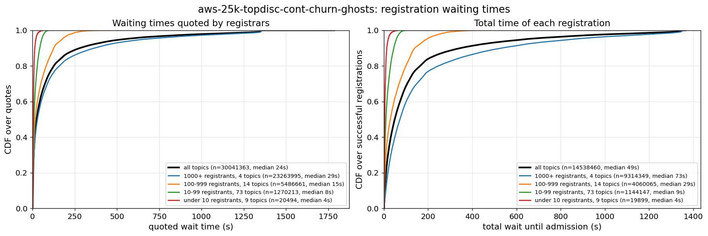

*(a) Waiting times quoted by registrars; (b) total time of every successful registration, from its first REGTOPIC to admission.*

**Reading.** Registrars quote a median wait of 25 s and registrations complete in a median 50 s, down to 4 s for topics under 10 registrants. Every registration completes within about 1,350 s, the 1.5 × ad lifetime budget, so admission cost is bounded.

### oh_08_cache_utilisation

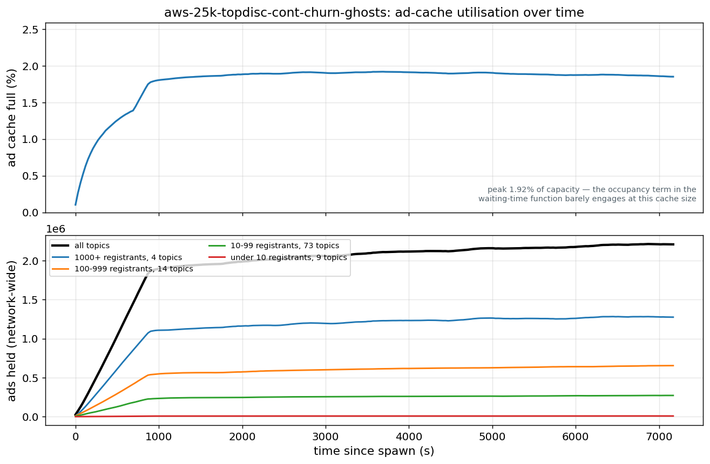

*Ads held network-wide and per topic against cache capacity, over time.*

**Reading.** Ads held network-wide reach about 1.9 million by the end of the registration window and climb slowly to 2.2 million; caches are at most 1.92 % full. Registrations stay in place for the whole run under churn, and cache size never limits them.

## 2. Discovery

### Search summary

| metric | TopDisc | discv5 |
|---|---:|---:|
| searchers | 24,967 | 24,946 |
| found at least one provider | 98.4 % | 99.0 % |
| time to first provider, p50 / p95 | 1.2 s / 57.5 min | 0 ms / 58.3 min |
| first provider already in the routing table | – | 59 % |
| **all topics**: share found at the end, median | 99.5 % | 71.3 % |
| &nbsp;&nbsp;time to 50 %, median | 87.1 s (95 % reach) | 36.4 min (84 % reach) |
| &nbsp;&nbsp;time to 90 %, median | 17.8 min (93 % reach) | not reached by half (0 % reach) |
| &nbsp;&nbsp;time to 99 %, median | 83.3 min (81 % reach) | not reached by half (0 % reach) |
| &nbsp;&nbsp;time to 100 %, median | not reached by half (11 % reach) | not reached by half (0 % reach) |
| **1000+ nodes (4 topics)**: share found at the end, median | 99.5 % | 71.7 % |
| &nbsp;&nbsp;time to 50 %, median | 112.4 s (93 % reach) | 35.7 min (85 % reach) |
| &nbsp;&nbsp;time to 90 %, median | 17.8 min (91 % reach) | not reached by half (0 % reach) |
| &nbsp;&nbsp;time to 99 %, median | 83.1 min (85 % reach) | not reached by half (0 % reach) |
| &nbsp;&nbsp;time to 100 %, median | not reached by half (0 % reach) | not reached by half (0 % reach) |
| **100-999 nodes (14 topics)**: share found at the end, median | 99.4 % | 69.7 % |
| &nbsp;&nbsp;time to 50 %, median | 13.3 s (98 % reach) | 38.7 min (85 % reach) |
| &nbsp;&nbsp;time to 90 %, median | 20.7 min (96 % reach) | not reached by half (0 % reach) |
| &nbsp;&nbsp;time to 99 %, median | 85.0 min (72 % reach) | not reached by half (0 % reach) |
| &nbsp;&nbsp;time to 100 %, median | not reached by half (14 % reach) | not reached by half (0 % reach) |
| **10-99 nodes (73 topics)**: share found at the end, median | 100.0 % | 70.5 % |
| &nbsp;&nbsp;time to 50 %, median | 2.5 s (97 % reach) | 36.5 min (83 % reach) |
| &nbsp;&nbsp;time to 90 %, median | 7.6 s (94 % reach) | not reached by half (2 % reach) |
| &nbsp;&nbsp;time to 99 %, median | 61.2 min (74 % reach) | not reached by half (0 % reach) |
| &nbsp;&nbsp;time to 100 %, median | 61.2 min (74 % reach) | not reached by half (0 % reach) |
| **under 10 nodes (9 topics)**: share found at the end, median | 100.0 % | 71.4 % |
| &nbsp;&nbsp;time to 50 %, median | 2.3 s (100 % reach) | 34.1 min (78 % reach) |
| &nbsp;&nbsp;time to 90 %, median | 2.9 s (100 % reach) | not reached by half (19 % reach) |
| &nbsp;&nbsp;time to 99 %, median | 2.9 s (100 % reach) | not reached by half (19 % reach) |
| &nbsp;&nbsp;time to 100 %, median | 2.9 s (100 % reach) | not reached by half (19 % reach) |


*Two tails are worth reading against the same workload without churn (Grid’5000, see the separate no-churn report). Time to first provider at the 95th percentile is 57.5 min with churn against 4.9 s without: about 5 % of searchers wait most of the search for a first provider while providers leave and rejoin. Searchers that find no provider at all are 1.6 % with churn and 1.5 % without, so that share is not a churn effect; with churn, 91.5 % of them stopped searching within a minute of starting.*

### cp_01_found_over_time

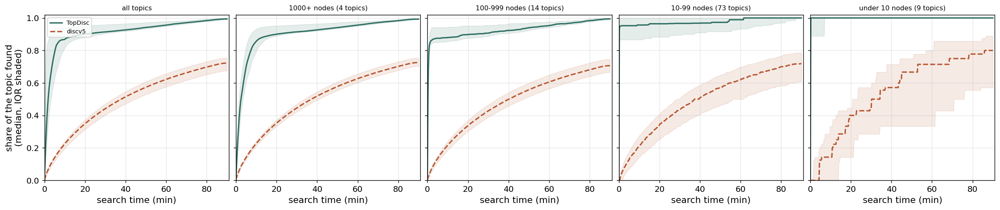

*Share of its topic's other nodes each searcher had found, against time since its search started: median line, interquartile range shaded.*

**Reading.** TopDisc's median searcher passes 85 % of its topic within about 5 min and ends at 99.5 %; discv5 climbs steadily to 71.3 %. TopDisc finds providers faster and more completely in every size class, and small topics almost at once.

### Share of the topic found by the end

| Topics | TopDisc searchers | TopDisc: median | discv5: median | TopDisc: 10th pct | discv5: 10th pct | TopDisc: ≥ 90 % | discv5: ≥ 90 % | TopDisc: none found | discv5: none found |
|---|---|---|---|---|---|---|---|---|---|
| all topics | 24,967 | 99.5 % | 71.3 % | 95.9 % | 23.5 % | 92.9 % | 0.3 % | 1.6 % | 1.1 % |
| 1000+ | 16,149 | 99.5 % | 71.7 % | 94.8 % | 20.1 % | 91.5 % | 0.0 % | 1.6 % | 0.6 % |
| 100–999 | 6,219 | 99.4 % | 69.7 % | 97.7 % | 31.1 % | 95.9 % | 0.0 % | 1.0 % | 0.8 % |
| 10–99 | 2,550 | 100.0 % | 70.6 % | 95.8 % | 18.3 % | 94.3 % | 2.6 % | 2.6 % | 4.7 % |
| under 10 | 49 | 100.0 % | 71.4 % | 100.0 % | 27.9 % | 100.0 % | 22.4 % | 0.0 % | 4.1 % |

*Share of its topic each searcher had found when the search phase ended; under churn, of the providers up at the end. Topic size classes by registrants.*


### cp_08_time_to_fraction

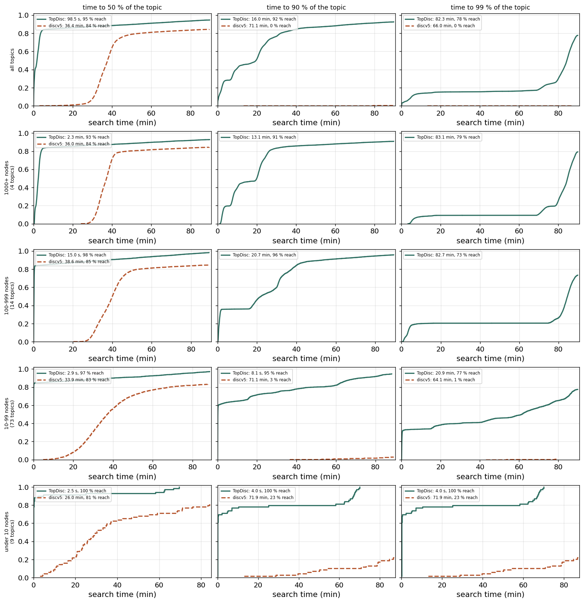

*Time for each searcher to find 50 %, 90 % and 99 % of its topic, by topic size. Searchers that never got there count in the denominator, so a curve ends at the share that did; the legend gives the median time of those that did.*

**Reading.** TopDisc takes 95 % of searchers to 50 % and 93 % to 90 % of their topic; discv5 reaches 90 % for almost none. With churn, time to 90 % for topics over 100 nodes is still 8 to 20 min.

### cp_09_discovery_rate

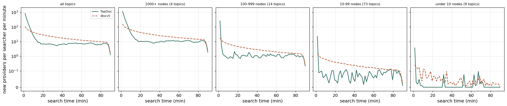

*New providers found per searcher per minute over the search, by topic size: how fast each protocol is still learning.*

**Reading.** TopDisc finds hundreds of providers per searcher per minute at the start, then drops below discv5's rate. Discovery is front-loaded as intended: by then TopDisc has already found most of each topic (cp_01).

### Time to the first provider

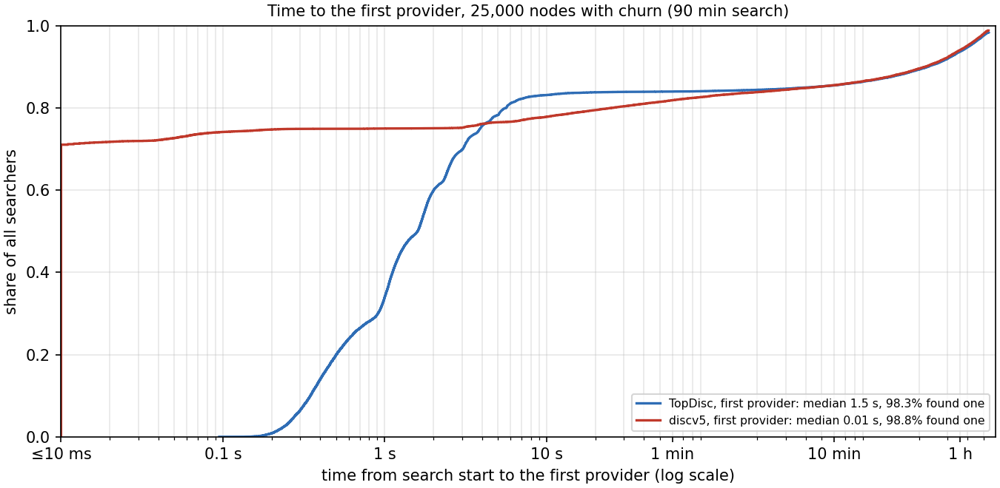

*Share of all searchers that had found a provider, against time since their search started, on a log time axis. discv5 starts high because 60 % of its searchers already had a provider in their routing table. Counting any provider found, rather than only providers up at the end, gives the same curves.*

**Reading.** TopDisc gives 83 % of searchers a provider within 10 s (median 1.2 s); discv5 starts at about 71 %. Both runs leave about 15 % waiting over 10 min and under 2 % find none; TopDisc does not shorten that tail.


*The slow climb from 84 % to 98 % between 10 min and the end of the search is churn, for both protocols: searchers whose providers were down, or who left themselves, find their first provider only after rejoins. Without churn (Grid’5000) TopDisc's curve is flat at 98.5 % after 10 s, with nothing found later.*

### cp_10_search_requests

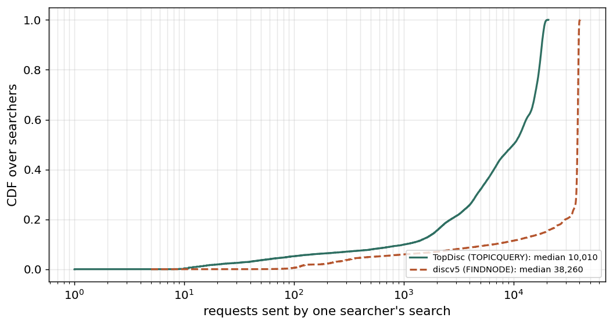

*Requests each searcher's own search sent: TOPICQUERY for TopDisc, FINDNODE for the plain walk (fork build).*

**Reading.** A TopDisc searcher sends a median 11,459 TOPICQUERY requests over the search, against 43,741 FINDNODE requests for discv5. TopDisc reaches its higher recall with about a quarter of the requests.

### cp_11_lookup_latency

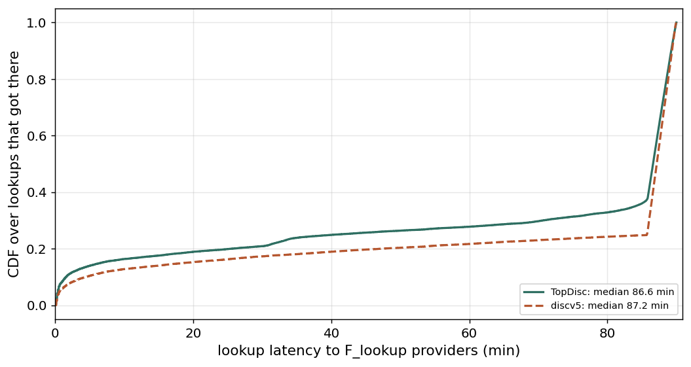

*Scheduled lookups: time to reach F_lookup distinct providers.*

**Reading.** Lookups reach F_lookup providers at a median 86.6 min for TopDisc and 87.2 min for discv5, so this view shows no clear gain. TopDisc completes more lookups early, about 35 % before 85 min against 25 %.

### cp_12_idspace_found_share

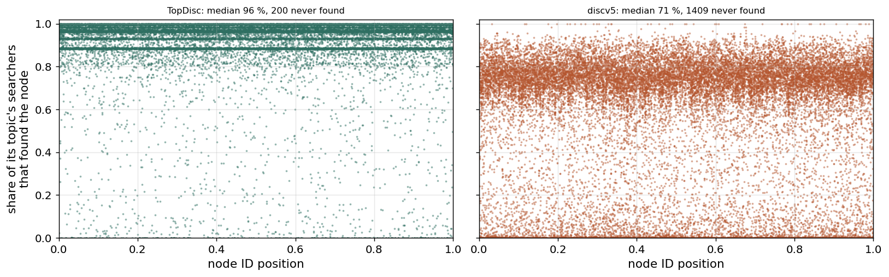

*For each provider, the share of the other searchers of its topic that found it, across the ID space.*

**Reading.** A median provider is found by 96 % of its topic's searchers with TopDisc against 71 % with discv5, evenly across the ID space. TopDisc still left 200 providers unfound, against 1,409 for discv5.

### 12_search_bucket (TopDisc only)

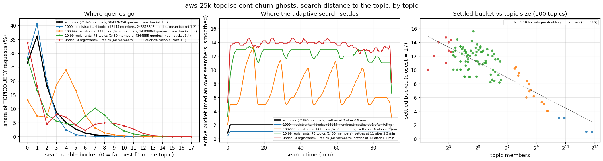

*Where searches query: share of TOPICQUERY requests per search-table bucket (0 = farthest from the topic) and, for adaptive searches, the median active bucket over search time.*

**Reading.** The adaptive search settles where ads are dense: bucket 1 to 3 for the four largest topics and 11 to 13 for topics under 100 nodes, one bucket per size doubling (r = -0.82). Popular topics are not queried at their closest registrars.

### oh_06_idspace_found_time (TopDisc only)

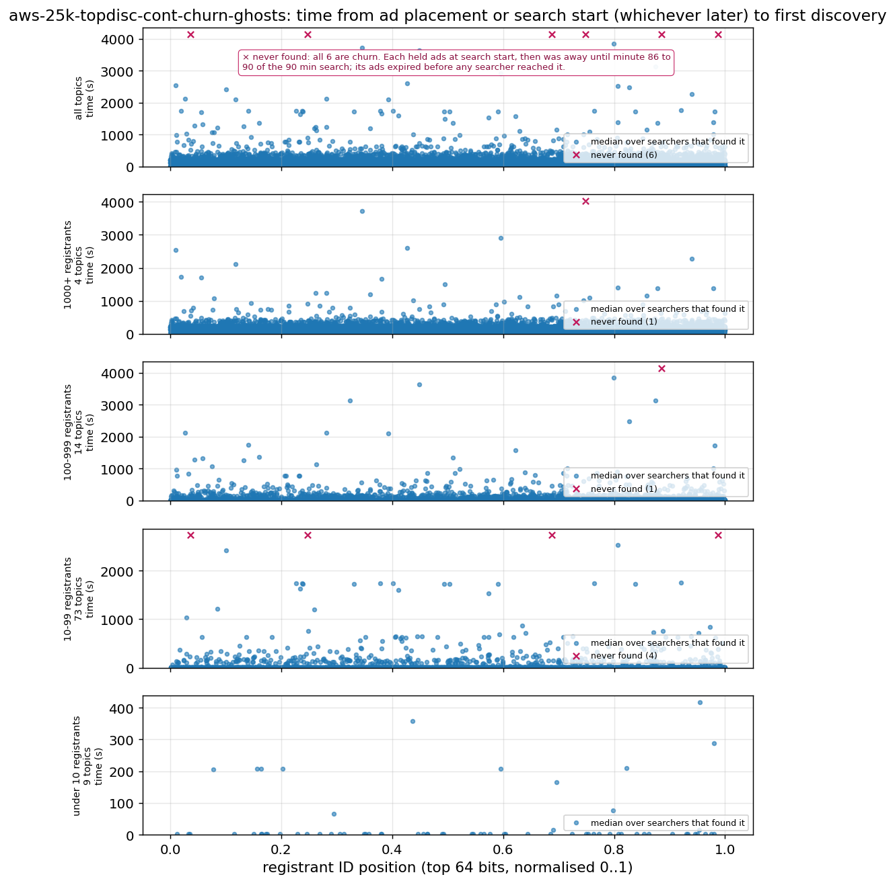

*Time from when an ad could first be found (placed, with searches running) to its first discovery, across the ID space.*

**Reading.** Most ads are first found within a few hundred seconds of placement, with no ID-space region left behind. Five providers were never found, and a few ads in topics of 100 or more registrants waited over 3,000 s.

*The 5 never-found registrants are churn. Each held ads when the search started, but its trace shows it up again only in the last minutes of the search (from minute 86 to 90): it was away for nearly the whole search, its ads expired, and it came back too late to be found.*


## Dead nodes in search results

A search result is dead when it points at a node that was down at the moment the searcher received it. Every result of the 90 min search was checked against each node's trace and the churn schedule.

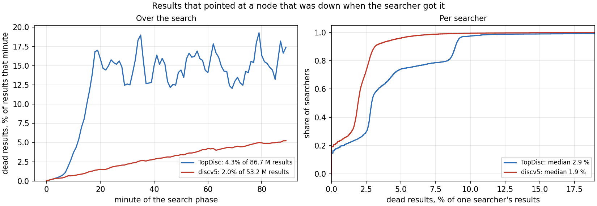

**Reading.** TopDisc hands out more dead results, 4.3 % overall and 12 to 19 % of each minute's results after minute 20, but only 45 were down longer than an ad lifetime: a departed node's ad expires within 15 min. discv5 returns fewer dead results, 2.0 %, yet 202,713 had been down over 15 min, from routing-table entries that do not expire.

| | Results | Dead when handed out | Dead for longer than an ad lifetime (15 min) |
|---|---:|---:|---:|
| TopDisc | 86,715,547 | 3,747,905 (4.3%) | 45 (0.00%) |
| discv5 | 53,189,055 | 1,089,983 (2.0%) | 202,713 (0.38%) |

*Down is counted from the node's own trace where it covers the moment, else from the churn schedule. Results are counted each time a searcher received them.*

## 3. Overhead and load

### Load summary

| metric | TopDisc | discv5 |
|---|---:|---:|
| sent per node, whole run, p50 / p95 | 25 MB / 100 MB | 33 MB / 69 MB |
| requests served per node, whole run, p50 / max (bootnode left out) | 11,634 / 152,623 | 13,838 / 263,694 |
| reply bytes sent per node, whole run, p50 / max (bootnode left out) | 17 MB / 342 MB | 26 MB / 607 MB |
| bootnode: requests served / reply bytes sent, whole run | 312,698 / 276 MB | 430,217 / 681 MB |
| &nbsp;&nbsp;share of bytes sent: registration | 4.2 % | 0.0 % |
| &nbsp;&nbsp;share of bytes sent: topic search | 72.5 % | 0.0 % |
| &nbsp;&nbsp;share of bytes sent: DHT (FINDNODE/NODES) | 20.0 % | 97.0 % |
| &nbsp;&nbsp;share of bytes sent: liveness (PING/PONG) | 1.3 % | 1.3 % |
| &nbsp;&nbsp;share of bytes sent: session and other | 2.0 % | 1.7 % |

### cp_13_idspace_traffic

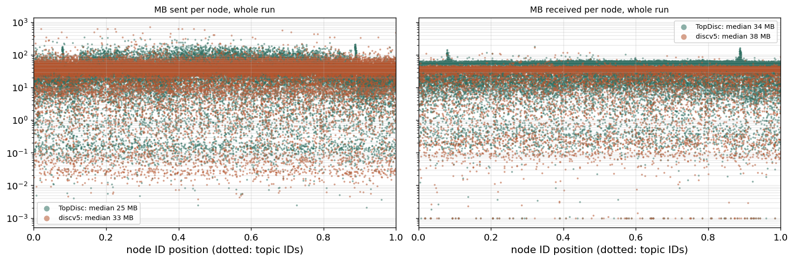

*Bytes each node sent and received over the whole run, against its position in the ID space.*

**Reading.** The median node sends 25 MB and receives 34 MB with TopDisc, against 33 and 38 MB with discv5, evenly across most of the ID space. Narrow spikes near two topic IDs reach about 200 MB sent.

### cp_14_msgtype

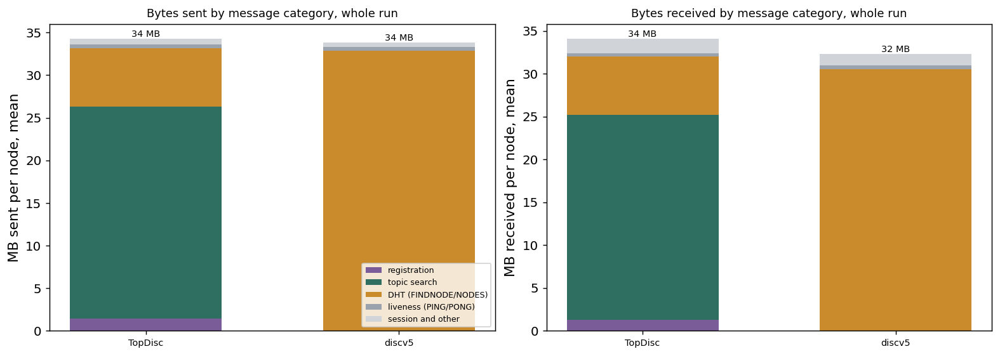

*Mean bytes per node by message category over the whole run: registration, topic search, DHT walk, liveness and session setup.*

**Reading.** Both protocols send a mean 34 MB per node. TopDisc replaces most DHT walk traffic with topic search, and registration costs about 1.4 MB per node, so discovery costs no more on average.

### cp_04_traffic_over_time

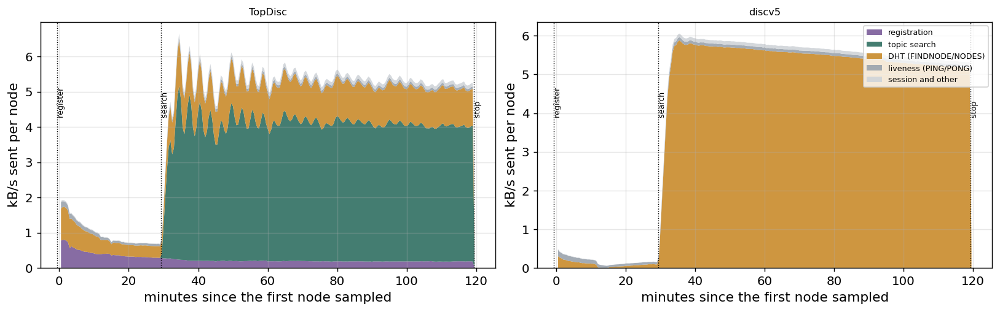

*Bytes sent per node per second, by message category, over the whole run; dotted lines mark the phases. Each panel has its own y scale.*

**Reading.** During search TopDisc nodes send 5.4 to 8.4 kB/s, peaking every 15 min, against about 7 kB/s for discv5; registration stays below 0.3 kB/s. The TopDisc rate does not fall toward the end, so it keeps querying after most providers are found.

### cp_15_peak_rate_idspace

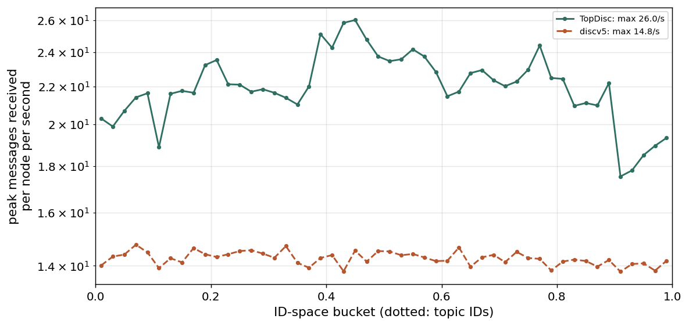

*Highest sustained receive rate per node (3-sample moving window) in each ID-space bucket, over the whole run.*

**Reading.** TopDisc's highest sustained receive rate per node is 26.0 messages/s against 14.8 for discv5, ranging from about 17.5 to 26 across the ID space. Peaks are higher with TopDisc, highest around ID position 0.4 to 0.46, but stay bounded.

### cp_16_load_vs_topic_distance

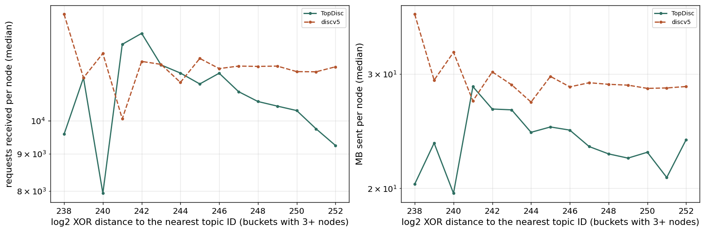

*Load against a node's distance to the closest topic ID. TopDisc concentrates registrations and queries near topic IDs; a plain walk does not depend on topics.*

**Reading.** At most distances TopDisc nodes receive fewer requests and send fewer bytes than discv5 nodes. Load peaks at log2 distance 241, above discv5 there (about 39 against 31 MB sent), while the closest nodes, at 238 to 240, carry less.

### cp_17_cost_vs_topic_size

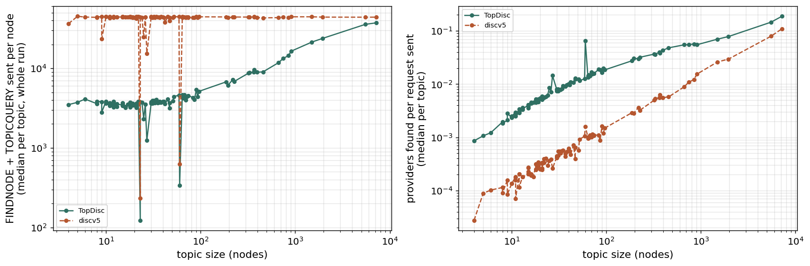

*Discovery requests each node sent over the whole run, and providers found per request, against the size of its topic. Whole-run counts include table upkeep and, for TopDisc, registration walks.*

**Reading.** TopDisc nodes send fewer discovery requests than discv5 at every topic size and find 2 to 30 times more providers per request. Nodes of topics under 100 nodes still send about 3,000 to 4,000 requests, though their topics are found within seconds.

### cp_06_serving_load

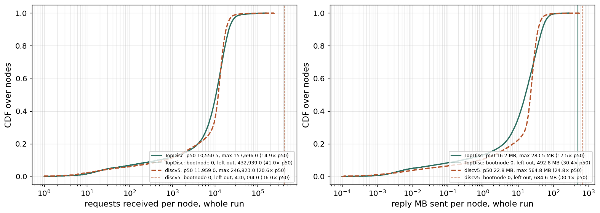

*Load each node carries for others over the whole run: requests received (FINDNODE, TOPICQUERY, REGTOPIC, PING) and bytes of the replies it sent (NODES, TOPICNODES, REGCONFIRMATION, PONG). The bootnode is in every routing table: it is left out of the CDFs and drawn as a vertical line.*

**Reading.** Median requests served are 11,875 for TopDisc and 14,118 for discv5; the busiest non-bootnode serves 152,623 against 263,694. The bootnode serves about 313,000 with TopDisc, 26 times the median, against 430,000 under discv5.

### oh_10_reg_vs_lookup (TopDisc only)

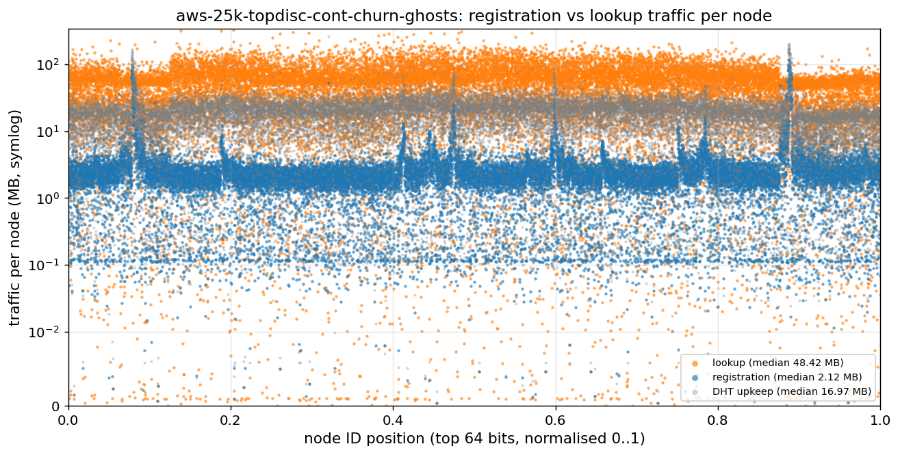

*Registration vs lookup traffic per node.*

**Reading.** Per node, lookup traffic has a median of 48.4 MB, DHT upkeep 17.0 MB and registration 2.1 MB, so registration is a small part of the cost. Registration traffic rises to 100 to 200 MB near the two largest topic IDs.

### oh_11_topic_load (TopDisc only)

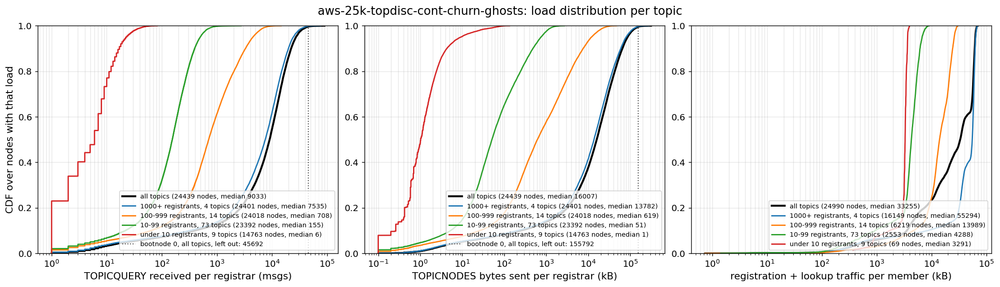

*Load distribution per topic: search requests (TOPICQUERY) received and TOPICNODES bytes sent per registrar, and registration and lookup traffic per member.*

**Reading.** Registrars receive a median 7,535 TOPICQUERY requests for the largest topics and 6 for topics under 10, so load follows topic size. The busiest registrar receives 10.2 times the median, above the 10× limit; the bootnode receives 45,692, about 5 times.

## 4. Churn

Each departure's trace is kept and merged, so the counters cover every session; found and target count the providers that were up at the end of the search.

| metric | TopDisc | discv5 |
|---|---:|---:|
| departures with a kept trace | 8,176 | 8,208 |
| nodes that left at least once | 4,002 | 4,012 |
| searchers with a provider down at the end | 22,545 of 24,967 | 22,524 of 24,946 |
| providers up at the end, share of the topic, median / min | 88 % / 32 % | 88 % / 32 % |
| found at the end, share of the providers up, median | 99 % | 71 % |

## 5. Run health

| metric | TopDisc | discv5 |
|---|---:|---:|
| node CPU, p95 / max | 3 % / 13 % | 2 % / 9 % |
| node RSS, p95 / max | 47 / 161 MB | 38 / 51 MB |
| UDP receive-buffer drops | 0 | 0 |

TopDisc:

```
hostmetrics: 12500 samples over 50 hosts; node cpu% p50=0 p95=2 max=13; rss MB p50=30 p95=46 max=160; 1192568 packet drops (treat timings with care): netem 251796, namespace UDP receive buffer 887, ARP 0, ENA allowance 939885, host UDP receive buffer 0
```

discv5:

```
hostmetrics: 12039 samples over 50 hosts; node cpu% p50=1 p95=1 max=9; rss MB p50=27 p95=38 max=50; 879268 packet drops (treat timings with care): netem 1394, namespace UDP receive buffer 0, ARP 0, ENA allowance 877874, host UDP receive buffer 0
```

Every node runs plain discv5, so the TopDisc registration and topic-search figures are left out. `compare_protocols.py` puts this run next to its TopDisc pair.

## Not in this report

| item | reason |
|---|---|
| `cp_05_search_cost` | no run with counter samples covering the search phase |
| `cp_18_dead_results` | no dead-result data (simnet churn runs only) |

## Grid'5000 without churn vs AWS with churn

The same 25,000-node workload ran on Grid'5000 without churn and with a 6 h search, against the AWS run above with churn and a 90 min search. Without churn and given hours, discv5 finds nearly every provider; TopDisc gets there in minutes. With churn, TopDisc keeps its recall and discv5 loses a quarter of it.

| Metric | Grid'5000, no churn: TopDisc | Grid'5000, no churn: discv5 | AWS, churn: TopDisc | AWS, churn: discv5 |
|---|---:|---:|---:|---:|
| Search phase | 6 h | 6 h | 90 min | 90 min |
| Recall, median | 98.5 % | 99.5 % | 99.5 % | 71.3 % |
| Time to 50 % of providers, median | 42.5 s | 42.8 min | 87 s | 36.4 min |
| Time to 90 %, median | 2.7 min | 2.5 h | 17.8 min | not reached |
| Time to first provider, median | 1.2 s | 0 s (62 % in table) | 1.2 s | 0 s (59 % in table) |
| Found at least one provider | 98.5 % | 100.0 % | 98.4 % | 99.0 % |
| Time to 90 %, topics of 10 to 99 nodes | 3.3 s | 2.5 h | 7.6 s | not reached |

- **Without churn** a random walk eventually meets every provider, so discv5's recall ends at 99.5 % after 6 h. The cost is time: half of a topic's providers after 43 min, 90 % after 2.5 h.
- **With churn** providers leave and rejoin during the search and only those still up count. A 90 min walk does not keep up: discv5 ends at 71.3 %. TopDisc finds providers through registrars that hold fresh ads, so its recall stays at 99.5 %.
- TopDisc takes longer to reach 90 % with churn: 17.8 min against 2.7 min without.
- On Grid'5000, 375 TopDisc searchers (1.5 %) found no provider at all.
- Grid'5000 runs used fork `v1.17.2-testbed.14`; the hosts ran 500 to 521 nodes each, and discv5 hosts were CPU-saturated.

Grid'5000 pair, found over time and time to reach a share of providers:

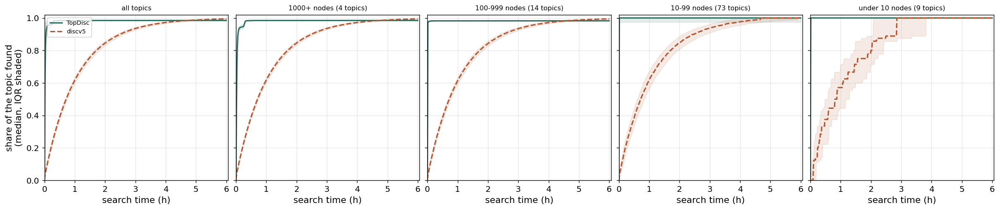

**Reading.** Without churn, TopDisc's median searcher reaches about 98 % within minutes and stays there; discv5 takes about 5 h to pass it and ends at 99.5 %. TopDisc answers hours sooner, but its final recall is one point lower.


**Reading.** Without churn, TopDisc takes 98 % of searchers to 90 % of their topic at a median 2.6 min, against 2.5 h for discv5. Only 8 % of TopDisc searchers reach 99 %, against 88 % for discv5 after 5.2 h.

## Partial deployment

TopDisc searchers find the TopDisc providers of their topic at every share tested, and nodes that do not run TopDisc are not hurt. Full analysis, with results by topic size and the coexistence checks: [partial deployment report](deploy/). Four 5,000-node AWS runs with churn and the same workload as above (fork `v1.17.2-testbed.23`, 90 min search) ran TopDisc on 25, 50, 75 and 100 % of the nodes, drawn within every topic; the rest ran plain discv5. A 0 % run is the plain baseline. TopDisc searchers are scored against the TopDisc providers of their topic, plain searchers against all providers, counting only providers up at the end.


| TopDisc share | TopDisc recall, median / 10th pct | TopDisc time to 50 % / 90 % | Plain recall, median | Plain time to 50 % | Registrar requests, median / busiest |
|---:|---:|---:|---:|---:|---:|
| 0 % | – | – | 89.9 % | 7.7 min | – |
| 25 % | 100.0 / 94.7 % | 5.3 s / 9.0 min | 91.5 % | 7.5 min | 1,785 / 11,614 |
| 50 % | 99.8 / 95.5 % | 7.6 s / 18.1 min | 93.2 % | 7.4 min | 2,808 / 18,794 |
| 75 % | 99.8 / 96.2 % | 10.1 s / 15.8 min | 95.2 % | 7.4 min | 4,005 / 25,578 |
| 100 % | 99.8 / 97.1 % | 15.3 s / 11.7 min | – | – | 5,082 / 31,000 |

*Registrar requests are REGTOPIC plus TOPICQUERY received per TopDisc registrar over the run, bootnode left out.*

- **Every share works.** At 25 % TopDisc searchers reach a median 100 % of their providers and half of them in 5.3 s; plain searchers need 7.5 min for half of theirs.
- **Fewer TopDisc nodes do not overload registrars.** Load scales with the number of TopDisc nodes: at 25 % the busiest registrar receives 11,614 requests, against 31,000 at 100 %.
- **Plain nodes are not hurt.** No topic message reaches a plain node at any share (check I1 passes). Plain recall rises from 89.9 % at 0 % to 95.2 % at 75 %, and plain nodes send less: fewer plain walkers send FINDNODE to them. The rise is observed, not explained.
- **Small topics at low share.** At 25 %, 23 of 98 topics have no TopDisc node and 29 have exactly one, so a lone TopDisc node has nobody to find; such searchers are not scorable.
- **Time to 90 % is slower at 50 % and 75 % than at 25 % or 100 %.** These runs do not show why.

## Findings and fixes

The evaluation found these protocol problems. Each led to a change in the geth implementation and, where it changes behaviour, in the spec.

### Load concentration near the topic: adaptive search

The original search asked the registrars closest to the topic ID first and stayed there. On 858 real nodes the busiest registrar took 217,000 queries an hour, 25× the median. In the simulator the busiest-to-median ratio grew to 605× at 30,000 nodes and 19,099× at 250,000.

A topic search runs in **passes**. A pass builds a fresh search table from the node's routing table, sorted into 18 buckets by distance to the topic, and queries registrars one at a time, starting from the active bucket; it ends when that bucket is used up or after 32 queries. The next pass starts after a short gap and builds its table again.

The adaptive search ([#144](https://github.com/datahop/go-ethereum/pull/144)) moves the active bucket by the ad yield of recent replies: outward when replies are full, inward when they are empty, and it stays when they carry at least 8 ads. Each pass is capped at 32 queries, nodes asked in the last ad lifetime are not asked again, and the gap between passes that find nothing new grows from 2 s to 60 s. In the simulator the busiest-to-median ratio fell to 7.2× at 30,000 nodes and 33× at 250,000; the 25k AWS run with churn measured 10.2×.

### One registrar filling a reply: result filter and mixer

A single registrar could return all 16 results a searcher asked for. Sybil registrars answering only with sybil ads then eclipsed a share of searchers equal to the sybil share: 20.7 % at 20 % sybils, in the simulator at 30,000 nodes. Searches also returned the same registrants every pass.

The result filter suppresses a node already returned for one ad lifetime, and the mixer hands results out round-robin across at least 5 registrars, or after 5 s ([#140](https://github.com/datahop/go-ethereum/pull/140)). At 20 % sybils, full eclipse fell to 0.15 % of searchers. No rule helps when sybils are a majority of the registrars asked.

### Late ticket retries

Under churn, an advertiser's ticket retries queued behind first contacts to departed peers and reached registrars after the 5 s ticket window. Registrars dropped them without a reply, so advertisers took live registrars for dead ones and large topics were left with too few registrations to be found.

[#153](https://github.com/datahop/go-ethereum/pull/153) gives each topic 4 registration senders with ticket holders served first, and makes a registrar answer every REGTOPIC: a ticket up to 10 s late is credited, an early one is echoed back, and an invalid, expired or reused one starts a new attempt.

### Re-asking unreachable peers

Searches asked the same unreachable table entries again on every pass, and registrations retried them on every round of their registration loop. [#151](https://github.com/datahop/go-ethereum/pull/151) keeps a failed peer out for one ad lifetime, per search and per registration.

### Tickets

A ticket is the registrar's receipt for the time an advertiser has already waited, so the advertiser can come back later and be credited that wait instead of starting over. The registrar keeps no state for it: the ticket travels with the advertiser and is sealed with an HMAC under a key only the registrar holds, rotated every 6 h or 100,000 tickets.

A sealed ticket carries the topic, the advertiser's node ID, the wait it was quoted, when it was last used and when the waiting started. When an advertiser returns, the registrar checks the MAC, then compares the ticket's node ID with the node ID of the discv5 session the REGTOPIC arrived on. That ID comes from the session's handshake, which proves the sender holds the node's private key. A ticket presented by any other node is answered as a new attempt and stays redeemable by its owner ([#160](https://github.com/datahop/go-ethereum/pull/160), which fixed [#68](https://github.com/datahop/go-ethereum/issues/68): before it, tickets named only the topic and any node could use another's).

A ticket is valid in a 5 s window starting when its quoted wait ends, and is credited up to 10 s late. It is also single use: the registrar remembers each redeemed ticket by its MAC for the length of the window plus the grace, so the same ticket cannot be replayed within its window ([#153](https://github.com/datahop/go-ethereum/pull/153), which fixed [#69](https://github.com/datahop/go-ethereum/issues/69)).

### Other fixes

| Problem | Fix |
|---|---|
| Recall stalled near 20 % as the closest registrars locked in | waiting-time lower bound, [#105](https://github.com/datahop/go-ethereum/pull/105) |
| Wait-time overflow at high occupancy admitted every ad on amd64 | 24 h cap, [#155](https://github.com/datahop/go-ethereum/pull/155) |
| Advertisers dropped registrars that quoted under 1 s | clamp to 1 s, [#157](https://github.com/datahop/go-ethereum/pull/157) |
| Registration buckets mislabelled: the 4 closest held 2.8, 1.0, 0.4 and 0 of 5 | label bucket i as distance 256−i, [#145](https://github.com/datahop/go-ethereum/pull/145) |
| IPv4 and IPv6 scored on different scales | normalise by effective depth, [#84](https://github.com/datahop/go-ethereum/pull/84) |
| Ads could point at a third party's address | record IP must equal the packet source, [#107](https://github.com/datahop/go-ethereum/pull/107) |
| Ad cache jammed under sustained load | keep the cache ordered by expiry, [#99](https://github.com/datahop/go-ethereum/pull/99) |
| IP tracker counters drifted under churn | remove IPs only to their inserted depth, [#159](https://github.com/datahop/go-ethereum/pull/159) |

### Spec status

The behaviour changes above are written into the spec amendments in datahop/devp2p: [#15](https://github.com/datahop/devp2p/pull/15) (merged into #13's branch) → [#13](https://github.com/datahop/devp2p/pull/13) → [#11](https://github.com/datahop/devp2p/pull/11) (into `master`). The wait-time lower bound is already in `master`. Still to add:

1. The ticket binding to the advertiser's node ID (#160); the spec's ticket-transfer text is stale.
2. The spec asks tickets to bind an `adDigest` (record and payload); the code binds node ID and topic only.
3. Rate limiting of empty-ticket REGTOPIC ([#63](https://github.com/datahop/go-ethereum/issues/63)).
4. The REGTOPIC field order: the wire spec lists `[request-id, topic, ENR, ticket, distances]`, while the implementation encodes `[request-id, topic, ticket, ENR, distances]` (`v5wire/msg.go`).
5. Final values for `C`, `G`, `K_register` and `F_return` ([#12](https://github.com/datahop/go-ethereum/issues/12)).
