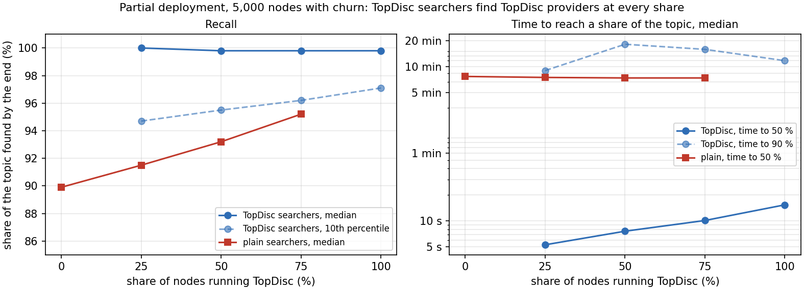
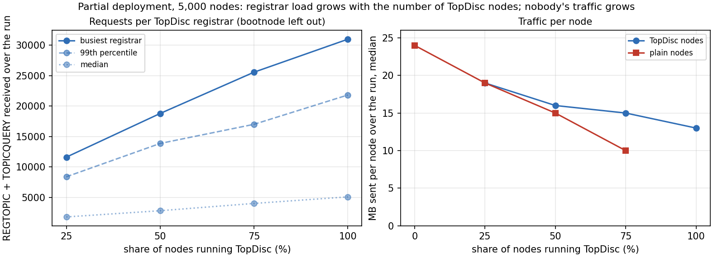

# TopDisc (DISC-NG): partial deployment

2026-10-27 · datahop/go-ethereum fork `v1.17.2-testbed.23` · datahop/topdisc-testbed · companion to [the main report](../)

## Summary

TopDisc nodes find the TopDisc nodes of their topic at every deployment share tested, from 25 % to 100 % of the network, and nodes that do not run TopDisc are not affected.

- The median TopDisc searcher finds 99.8 % to 100 % of its topic's TopDisc providers; 9 in 10 find at least 94.7 %.
- At 25 % deployment, TopDisc searchers reach half of their providers in 5.3 s; plain discv5 searchers need 7.5 min for half of theirs.
- Registrar load grows with the number of TopDisc nodes, so a small deployment does not concentrate load: the busiest registrar receives 11,614 requests at 25 % against 31,000 at 100 %.
- No topic message reaches a plain node at any share, and plain nodes send less traffic as the TopDisc share grows.

## Scenario and setup

Five 5,000-node runs on the AWS packed testbed (10 hosts, 500 nodes per host, each node with a 1 Mbit/s link and 4 to 45 ms one-way delay), each with a 90 min continuous search per node.

- **Deployment share.** TopDisc runs on 0, 25, 50, 75 or 100 % of the nodes, drawn within every topic, so each topic keeps roughly the run's share of TopDisc nodes. The other nodes run plain discv5 built from the same code base.
- **Topics.** 98 topics sized by the chain shares of a 24 h mainnet crawl. Every node registers and searches one topic.
- **Churn.** Node sessions replayed from the [crawl's churn analysis](../../churn-analysis.md), as in the main report.
- **Scoring.** A TopDisc searcher is scored against the TopDisc providers of its topic, a plain searcher against all providers of its topic, counting only providers up at the end of the search. A TopDisc node alone in its topic has nobody to find and is not scored.

## Discovery

| TopDisc share | Node type | Searchers / scored | Recall, median / 10th pct | First provider, median | Time to 50 % | Time to 90 % |
|---:|---|---:|---:|---:|---:|---:|
| 0 % | plain | 4,996 / 4,976 | 89.9 / 46.9 % | 0 ms | 7.7 min | not reached by half |
| 25 % | TopDisc | 1,228 / 1,196 | 100.0 / 94.7 % | 1.8 s | 5.3 s | 9.0 min |
| 25 % | plain | 3,767 / 3,748 | 91.5 / 49.6 % | 0 ms | 7.5 min | 77.1 min |
| 50 % | TopDisc | 2,478 / 2,450 | 99.8 / 95.5 % | 1.4 s | 7.6 s | 18.1 min |
| 50 % | plain | 2,520 / 2,504 | 93.2 / 48.8 % | 0 ms | 7.4 min | 66.2 min |
| 75 % | TopDisc | 3,735 / 3,706 | 99.8 / 96.2 % | 1.1 s | 10.1 s | 15.8 min |
| 75 % | plain | 1,263 / 1,260 | 95.2 / 48.7 % | 1 ms | 7.4 min | 57.0 min |
| 100 % | TopDisc | 5,000 / 4,980 | 99.8 / 97.1 % | 1.2 s | 15.3 s | 11.7 min |

*A plain searcher's first provider at 0 ms is a provider already in its routing table when the search starts. Times are medians over searchers.*

**Reading.** TopDisc's recall does not depend on the share: a TopDisc node finds the others through registrars, wherever they sit. Time to 50 % grows from 5.3 s to 15.3 s with the share, as each topic holds more TopDisc providers to collect. Plain searchers stay at the speed of a random walk, about 7.5 min to half of their topic.

### By topic size

The slower time to 90 % at 50 % and 75 % comes from the largest topics; topics under 1,000 nodes reach 90 % in seconds to minutes at every share.

#### Topics of 1000+ nodes

| TopDisc share | TopDisc recall, median / 10th pct | TopDisc time to 50 % / 90 % | plain recall, median / 10th pct | plain time to 50 % / 90 % |
|---:|---:|---:|---:|---:|
| 0 % | – | – / – | 90.0 / 42.8 % | 7.8 min / 89.0 min |
| 25 % | 99.7 / 94.0 % | 7.4 s / 18.6 min | 91.7 / 45.2 % | 7.5 min / 76.4 min |
| 50 % | 99.7 / 94.6 % | 11.3 s / 25.7 min | 93.6 / 46.1 % | 7.3 min / 64.9 min |
| 75 % | 99.8 / 95.8 % | 15.2 s / 16.3 min | 95.7 / 46.3 % | 7.3 min / 53.9 min |
| 100 % | 99.8 / 96.2 % | 22.7 s / 13.2 min | – | – / – |

#### Topics of 100-999 nodes

| TopDisc share | TopDisc recall, median / 10th pct | TopDisc time to 50 % / 90 % | plain recall, median / 10th pct | plain time to 50 % / 90 % |
|---:|---:|---:|---:|---:|
| 0 % | – | – / – | 90.3 / 67.1 % | 7.0 min / 79.9 min |
| 25 % | 100.0 / 100.0 % | 2.4 s / 7.4 s | 91.4 / 60.5 % | 7.1 min / 71.9 min |
| 50 % | 100.0 / 98.5 % | 2.6 s / 12.3 s | 91.9 / 55.9 % | 7.4 min / 68.3 min |
| 75 % | 100.0 / 97.5 % | 3.4 s / 16.4 s | 93.0 / 58.4 % | 7.4 min / 68.8 min |
| 100 % | 99.3 / 97.5 % | 4.5 s / 22.6 s | – | – / – |

#### Topics of 10-99 nodes

| TopDisc share | TopDisc recall, median / 10th pct | TopDisc time to 50 % / 90 % | plain recall, median / 10th pct | plain time to 50 % / 90 % |
|---:|---:|---:|---:|---:|
| 0 % | – | – / – | 87.1 / 51.5 % | 8.3 min / not reached by half |
| 25 % | 100.0 / 92.9 % | 2.3 s / 4.6 s | 89.9 / 62.5 % | 8.2 min / not reached by half |
| 50 % | 100.0 / 95.2 % | 1.9 s / 2.1 min | 90.7 / 63.2 % | 8.5 min / 83.8 min |
| 75 % | 100.0 / 95.3 % | 1.9 s / 8.1 min | 91.1 / 62.1 % | 8.8 min / 83.0 min |
| 100 % | 100.0 / 97.7 % | 2.1 s / 3.4 min | – | – / – |

#### Topics of under 10 nodes

| TopDisc share | TopDisc recall, median / 10th pct | TopDisc time to 50 % / 90 % | plain recall, median / 10th pct | plain time to 50 % / 90 % |
|---:|---:|---:|---:|---:|
| 0 % | – | – / – | 85.7 / 25.0 % | 8.7 min / not reached by half |
| 25 % | 100.0 / 100.0 % | 3.1 s / 3.1 s | 100.0 / 22.5 % | 8.9 min / 86.3 min |
| 50 % | 100.0 / 100.0 % | 2.4 s / 2.5 s | 100.0 / 25.0 % | 7.7 min / 76.3 min |
| 75 % | 100.0 / 100.0 % | 1.9 s / 2.0 s | 100.0 / 10.0 % | 10.2 min / 46.8 min |
| 100 % | 100.0 / 100.0 % | 2.1 s / 2.9 s | – | – / – |

## Load and traffic

| TopDisc share | Registrars contacted per search, median | Requests per registrar, median / 99th pct / busiest | Busiest / median (check A3, limit 10×) | MB sent per node, median: TopDisc / plain |
|---:|---:|---:|---:|---:|
| 0 % | – | – | – | – / 24 |
| 25 % | 744 | 1,785 / 8,384 / 11,614 | 7.3× | 19 / 19 |
| 50 % | 1,184 | 2,808 / 13,865 / 18,794 | 6.7× | 16 / 15 |
| 75 % | 1,596 | 4,005 / 17,011 / 25,578 | 6.3× | 15 / 10 |
| 100 % | 1,983 | 5,082 / 21,831 / 31,000 | 5.6× | 13 / – |

*Requests are REGTOPIC plus TOPICQUERY received per TopDisc registrar over the run, bootnode left out. A plain search is one continuous walk sending about 37,000 FINDNODE over the 90 min at every share.*

**Reading.** Load per registrar scales with the number of TopDisc nodes and stays within the 10× bound at every share. Plain nodes send less as the share grows, because fewer plain walkers send FINDNODE to them.

## Coexistence with plain nodes

| Check | What it asserts | 25 % | 50 % | 75 % |
|---|---|---|---|---|
| I1 | no REGTOPIC or TOPICQUERY sent to a plain node | pass | pass | pass |
| C4 | no plain node in any registrar's ad cache | pass | pass | pass |
| L2 | no plain node among TopDisc results | pass | pass | pass |
| I2 | plain nodes still find providers | 16 of 3,498 found none | 9 of 2,336 | 6 of 1,177 |

*I2 also fails in the 0 % run (17 of 4,625), with the same node ids across runs, so it comes from the workload and not from TopDisc.*

## Limits

- **Small topics at low share.** At 25 %, 23 of the 98 topics have no TopDisc node and 29 have exactly one. Those topics cannot be discovered through TopDisc; their nodes still find each other through the plain walk.
- **TopDisc finds TopDisc nodes only.** Plain nodes never register, and a node cannot register another node's record, so a TopDisc searcher sees plain providers only if it also runs the plain discv5 walk.
- **Plain recall rising with the share** (89.9 % to 95.2 %) is observed, not explained by these runs.
- **One seed per share.** Each share is a single run.
