# TopDisc (DISC-NG): evaluation without churn, Grid'5000

2026-10-27 · datahop/go-ethereum fork `v1.17.2-testbed.14` · datahop/topdisc-testbed · companion to [the main report](../), which runs the same workload with churn on AWS

## Summary

On 25,000 nodes without churn and with a 6 h search, TopDisc found a median 98.5 % of each topic's providers and plain discv5 99.5 %. The difference is time: TopDisc reached half of a topic's providers in 42.5 s and 90 % in 2.7 min; discv5 needed 42.8 min and 2.5 h.

- Without churn every provider stays up, so a random walk eventually meets nearly all of them; discv5's recall comes from the 6 h search.
- Small topics are found in seconds by TopDisc: 90 % in 3.3 s for topics of 10 to 99 nodes, against 2.5 h for discv5.
- 375 TopDisc searchers (1.5 %) found no provider at all.
- discv5 hosts ran 520 to 521 nodes each and were CPU-saturated.

## Scenario and setup

The two runs are a pair: the same workload and seed, with only the protocol changed. discv5 nodes run plain discv5 built from the same fork.

- **Network.** 25,000 nodes on 50 Grid'5000 machines (cluster `gros`, Nancy), 500 per machine, each node in its own network namespace with a 1 Mbit/s link, 4 to 45 ms one-way delay and 3 ms jitter.
- **Addresses.** Node IP prefixes drawn from the crawl's per-topic /24 histogram, so registrars see the IP diversity of mainnet and the admission IP score applies.
- **Topics.** The 100 largest chains of a 24 h crawl of the discv5 mainnet, each topic sized by its chain's share in the crawl. Every node registers and searches one topic.
- **No churn.** Every node stays up for the whole run.
- **Phases.** 3 min bootstrap, registration from +3 min with starts spread over 15 min, then one continuous 6 h search per node from 22.5 min after the start window.

**Metrics.** Recall is the median, over searchers, of the share of a topic's providers found. "Time to 50 %" and "time to 90 %" are medians over searchers of when they reached that share. Load is TOPICQUERY requests received per node, with the bootnode reported apart.

The sections below are generated by the testbed's paired report.


## Runs and parameters

| label | protocol | lookup model | nodes | topics | search phase | run directory |
|---|---|---|---:|---:|---:|---|
| TopDisc | TopDisc | continuous | 25,000 | 100 | 6.0 h | `slim-topdisc` |
| discv5 | plain discv5 | continuous | 25,000 | 100 | 6.0 h | `slim-discv5` |

### Parameters

Both runs use the same values; only the protocol differs. Topic values marked *fork default* are the defaults of fork `v1.17.2-testbed.14`; the scenario left them unset.

| Parameter | Value | What it sets |
|---|---|---|
| Nodes | 25,000 | 50 Grid'5000 `gros` machines, 500 nodes per machine |
| Topics | 100 | the 100 largest chains of the 2026-09-18 mainnet crawl; every node registers and searches one |
| Topic popularity | crawl chain shares (`crawl-2026-09-18.json`) | each topic's share of nodes is its chain's share in the crawl |
| Addresses | drawn from the crawl's per-topic /24 histogram | registrars see mainnet IP diversity |
| Seed | 1 | topic assignment and placement; same in both runs |
| Link | 1 Mbit/s, 4–45 ms one-way delay, 3 ms jitter | per node, in its own network namespace |
| Churn | none | every node stays up |
| Bootstrap | 3 min | nodes fill their routing tables before registering |
| Registration start | spread over 15 min, search starts 22.5 min after | avoids synchronised registrations and expiries |
| Search | continuous, 6 h, one search per node | the search keeps running and reports every provider it finds |
| Ad lifetime | 15 min (fork default) | how long a registrar keeps an ad |
| Ad cache | 5,000 ads | per registrar |
| Registration attempt budget | 1.5 × ad lifetime (fork default) | an advertiser drops a registrar whose waits add up to more |
| Registration table | 10 buckets × 5 registrars, 20 standby (fork default) | `K_register` = 5 |
| Search table | 10 buckets × 16 (fork default) | |
| Ads per reply (`F_return`) | 16 (fork default) | |
| Referrals per reply | 8 (fork default) | |
| Search yield floor | 8 (fork default) | ads per reply below which the search moves inward |
| Referral radius | 1 bucket (fork default) | |

### Topic assignment

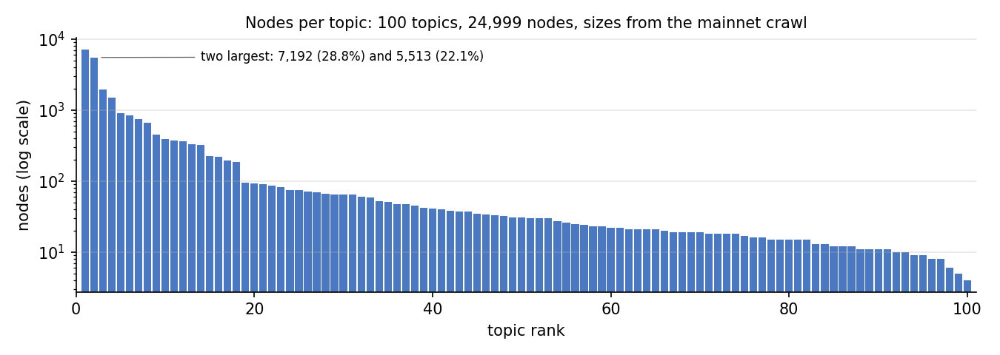

**Reading.** The 100 topics follow the mainnet crawl: the two largest hold 28.8 % and 22.1 % of the 24,999 nodes and the smallest has 4. One run tests very popular and very rare topics together.

| Topic size | Topics | Nodes | Share of nodes |
|---|---:|---:|---:|
| 1,000+ | 4 | 16,157 | 64.6% |
| 100–999 | 14 | 6,220 | 24.9% |
| 10–99 | 75 | 2,573 | 10.3% |
| under 10 | 7 | 49 | 0.2% |

Classes here count assigned nodes. The result tables below group topics by registrants, so a few small topics fall one class lower there.

## Correctness checks

`figures/checks.py` run on each full run (traces extracted to tmpfs), 2026-10-25. The table lists every check with both arms' status; the note explains TopDisc's non-pass results.

| check | group | TopDisc (10-20) | discv5 (10-12) | TopDisc note |
|---|---|---|---|---|
| **C1** | registration | pass | pass | capacity: ads held never exceed the cache size |
| **C2** | registration | pass | pass | no duplicates: one ad per advertiser and topic per registrar |
| **C3** | registration | pass | pass | only registrants: every held ad is from a node registering that topic |
| **C4** | registration | not-exercised | pass | only capable nodes: no legacy node in any cache. no legacy nodes in the run |
| **C5** | registration | pass | pass | no self-ads: a registrar never holds its own ad |
| **K1** | registration | not-exercised | not-exercised | departed nodes leave caches within an ad lifetime. no churn in the run |
| **E1** | registration | pass | pass | lifetime: expired ads are swept promptly and no ad expires beyond a lifetime |
| **E2** | registration | pass | needs-data | renewal keeps fan-out: final fan-out against the post-register level |
| **E3** | registration | pass | not-exercised | renewal accounting: renewals received match renewals sent beyond session setups |
| **W1** | registration | pass | needs-data | bounded wait: every admission within 2 % of the attempt timeout |
| **W2** | registration | pass | not-exercised | no early admission: admitted only after the required wait |
| **W3** | registration | **fail** | not-exercised | lower bound: a repeated quote never undercuts the previous one by more than the time elapsed. 787 of 18247940 repeated quotes undercut the lower bound |
| **W4** | registration | not-exercised | not-exercised | full cache admits nothing. no REGTOPIC arrived at a full cache (peak 1220 of 5000) |
| **W5** | registration | unit-test | unit-test | ticket validity: early, late, wrong-topic and bad-MAC tickets rejected. TicketSealer tests in the fork; rejection counters not traced |
| **W6** | registration | pass | not-exercised | record address: admitted record IP equals the packet source |
| **R1** | registration | pass | pass | bucket size: registered plus waiting never exceed the bucket size |
| **R2** | registration | pass | needs-data | bucket IP diversity: one registrar per /24 per bucket |
| **R3** | registration | **fail** | pass | state maintained: tables complete by search start and no bucket left empty with candidates. 15 final buckets idle with candidates left; over time needs periodic bucket samples; 2038 of 24999 tables were still filling at search start (register_wait) |
| **L1** | search | pass | pass | right topic: every result registers the requested topic |
| **L2** | search | not-exercised | pass | capable results: no legacy node among results. no legacy nodes in the run |
| **L3** | search | not-exercised | not-exercised | no expired results: no result down longer than a lifetime. no churn in the run |
| **L4** | search | pass | pass | termination: lookups end at the target or the timeout, hit flag consistent |
| **L5** | search | pass | not-exercised | reply limits: nodes per reply within the topic and aux limits |
| **L6** | search | pass | pass | no duplicate results within a lookup |
| **I1** | search | not-exercised | needs-data | no topic messages to legacy peers. no legacy nodes in the run |
| **I2** | search | not-exercised | pass | base discovery: legacy nodes still find providers. no legacy nodes in the run |
| **A1** | load | pass | not-exercised | request accounting: REGTOPIC and TOPICQUERY sent equal received |
| **A2** | load | pass | pass | every query answered: TOPICNODES sent at least TOPICQUERY received per node |
| **A3** | load | **fail** | not-exercised | registrar load bound: busiest registrar within a multiple of the median. busiest registrar at 12.7× the median, above 10.0× |
| **H1** | load | pass | pass | no packet drops on any host |
| **H2** | load | **fail** | pass | complete collection: a trace for every node. 1 of 25000 traces missing |
| **H3** | load | pass | pass | hosts under load: node CPU and host memory within limits |

## 1. Registration and cache (TopDisc only)

Plain discv5 nodes publish their service in their node record and register nothing, so this section has one run.

### 06_fanout_both_views

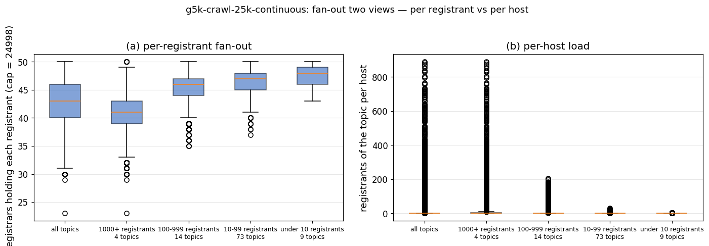

*(a) Registrars holding each registrant's ad; (b) ads held per registrar.*

**Reading.** The median registrant is held by 43 registrars, most between 34 and 50, with none below half the median. Per-registrar load in (b) is uneven: it reaches about 880 registrants per host for the largest topics.

### 04_id_space_registrants

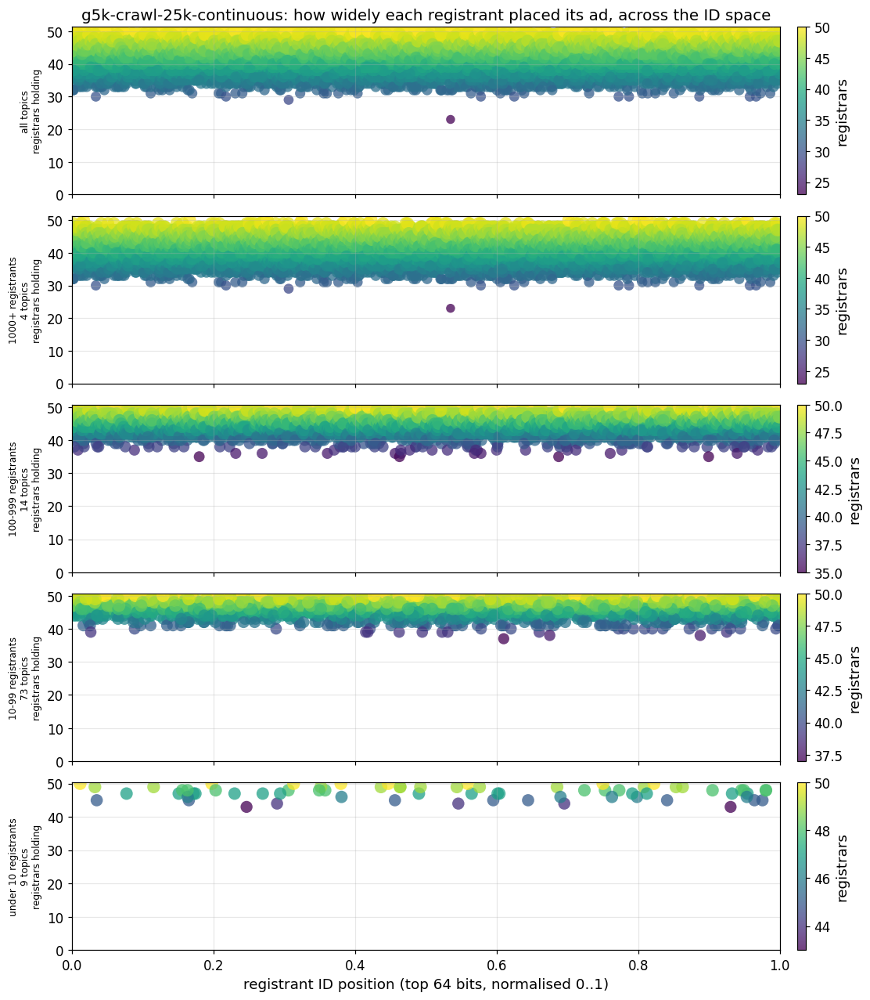

*Fan-out of each registrant across the ID space.*

**Reading.** Fan-out is flat across the ID space, between about 30 and 50 registrars in every size class, with a single registrant at 23. Placement does not depend on a registrant's ID, so no part of the ID space is underserved.

### 04b_id_space_registrars

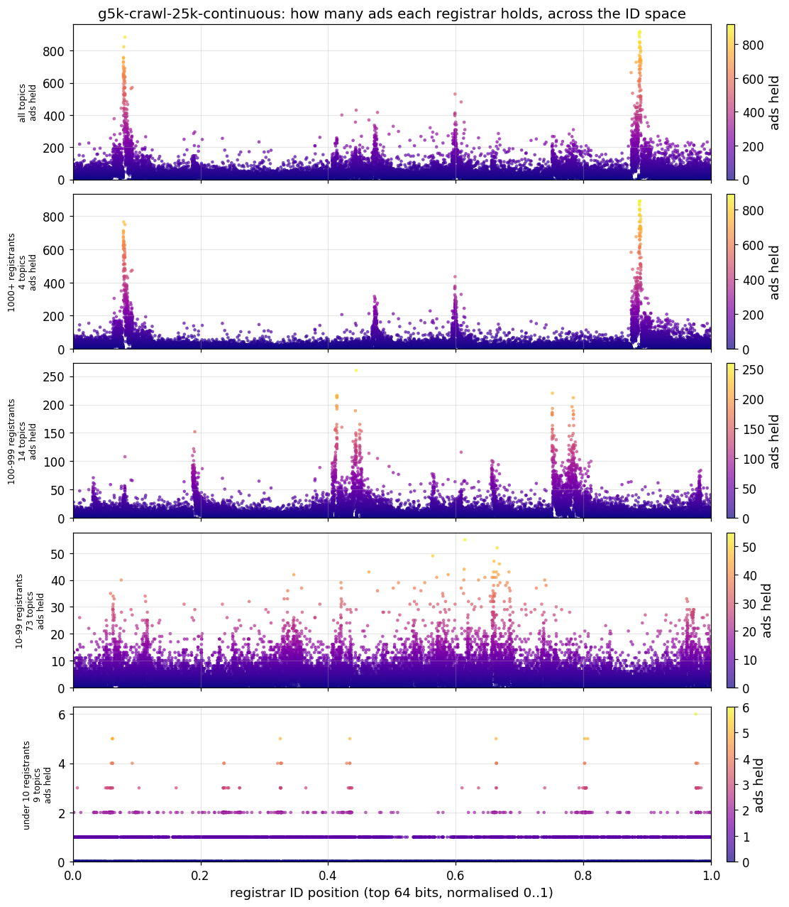

*Ads held by each registrar across the ID space.*

**Reading.** Most registrars hold under 200 ads, but registrars beside the two largest topic IDs hold up to about 900. Load concentrates near popular topic IDs, although every cache stays far below its 5,000-ad capacity.

### Cache occupancy across the ID space

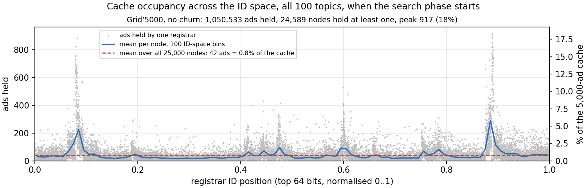

*Ads held per registrar over all topics when the search phase starts, with the mean per node in 100 ID-space slices and the mean over all nodes, as a share of the 5,000-ad cache.*

**Reading.** Registrars hold 42 ads on average, 0.8 % of the cache, and 24,589 of 25,000 nodes hold at least one. Occupancy is uneven: it peaks at 917 ads (18 %) beside the largest topic ID.

### 07_registration_latency_bar

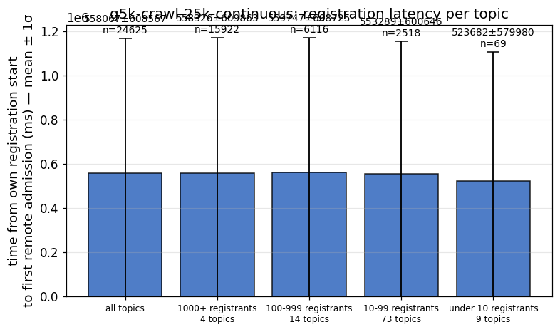

*Mean ± 1σ time to first remote admission per topic.*

**Reading.** Mean time to first remote admission is about 558 s with a standard deviation near 609 s, similar across size classes. A long tail pulls the mean up, so this view does not show fast registration; the median is 31.9 s.

### 07_placement_time_idspace

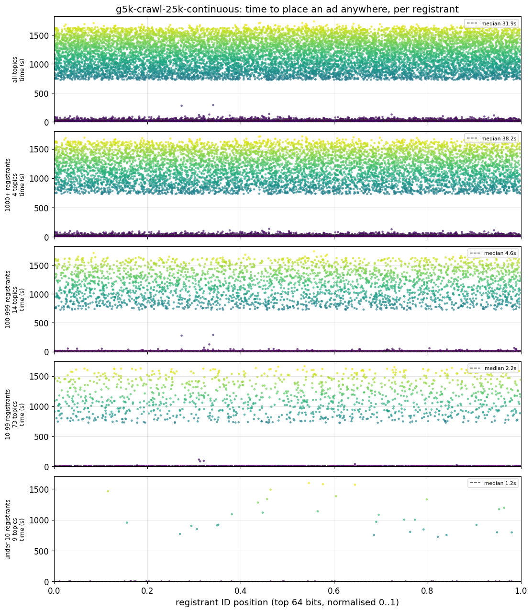

*Time to first admission across the ID space (earliest registrar).*

**Reading.** Median time to place an ad is 31.9 s overall, 38.2 s for the largest topics and 1.2 s under 10 registrants, flat across the ID space. A separate group of registrants in every class takes 750 to 1,700 s.

### oh_05_wait_time_cdf

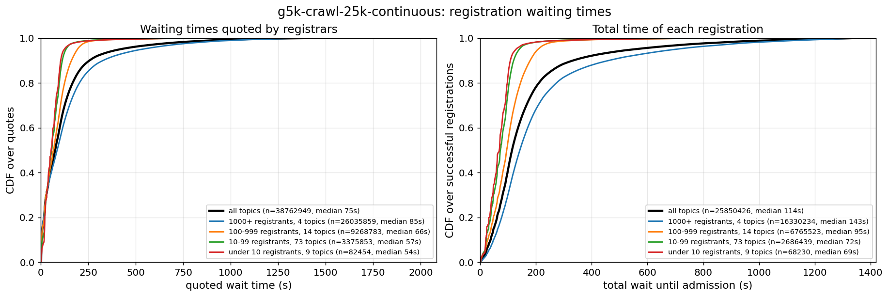

*(a) Waiting times quoted by registrars; (b) total time of every successful registration, from its first REGTOPIC to admission.*

**Reading.** Registrars quote a median wait of 75 s and registrations complete in a median 114 s, 69 s for the smallest topics. Every registration completes within about 1,350 s, the 1.5 × ad lifetime budget, so admission cost is bounded.

### oh_08_cache_utilisation

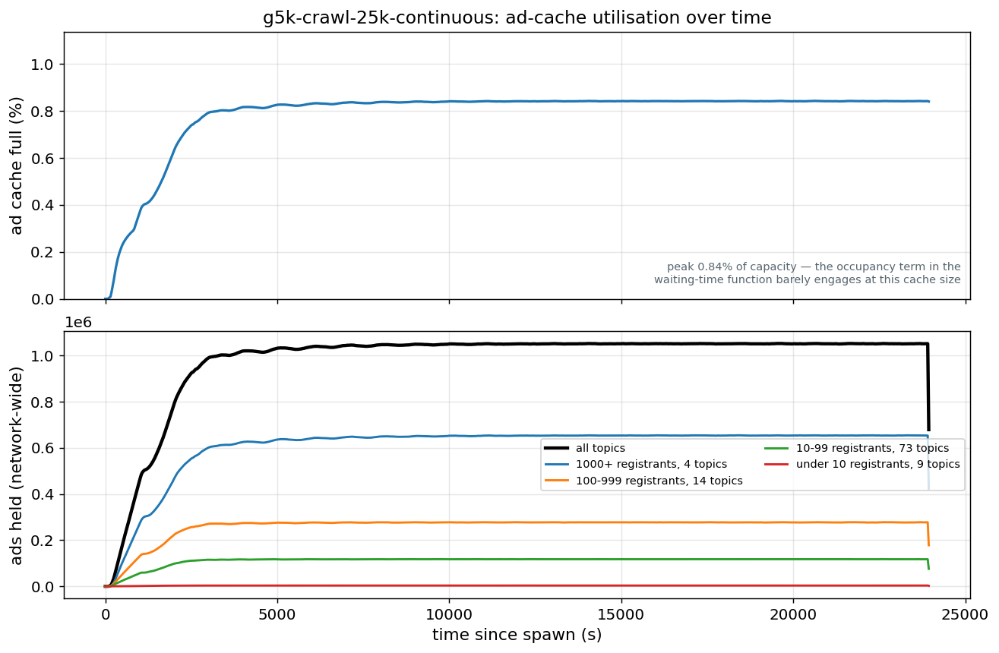

*Ads held network-wide and per topic against cache capacity, over time.*

**Reading.** Ads held network-wide plateau at about 1.05 million after roughly 5,000 s and stay flat for the 6 h search, with caches at most 0.84 % full. Registrations renew without loss and cache size never limits them.

## 2. Discovery

### Search summary

| metric | TopDisc | discv5 |
|---|---:|---:|
| searchers | 24,999 | 24,999 |
| found at least one provider | 98.5 % | 100.0 % |
| time to first provider, p50 / p95 | 1.2 s / 4.9 s | 0 ms / 63.7 s |
| first provider already in the routing table | – | 62 % |
| **all topics**: share found at the end, median | 98.5 % | 99.5 % |
| &nbsp;&nbsp;time to 50 %, median | 42.5 s (98 % reach) | 42.8 min (100 % reach) |
| &nbsp;&nbsp;time to 90 %, median | 2.7 min (98 % reach) | 2.5 h (100 % reach) |
| &nbsp;&nbsp;time to 99 %, median | not reached by half (8 % reach) | 5.2 h (88 % reach) |
| &nbsp;&nbsp;time to 100 %, median | not reached by half (7 % reach) | not reached by half (10 % reach) |
| **1000+ nodes (4 topics)**: share found at the end, median | 98.5 % | 99.4 % |
| &nbsp;&nbsp;time to 50 %, median | 68.4 s (98 % reach) | 42.7 min (100 % reach) |
| &nbsp;&nbsp;time to 90 %, median | 4.0 min (98 % reach) | 2.5 h (100 % reach) |
| &nbsp;&nbsp;time to 99 %, median | not reached by half (0 % reach) | 5.3 h (93 % reach) |
| &nbsp;&nbsp;time to 100 %, median | not reached by half (0 % reach) | not reached by half (0 % reach) |
| **100-999 nodes (14 topics)**: share found at the end, median | 98.3 % | 99.5 % |
| &nbsp;&nbsp;time to 50 %, median | 6.1 s (98 % reach) | 43.2 min (100 % reach) |
| &nbsp;&nbsp;time to 90 %, median | 17.1 s (98 % reach) | 2.5 h (100 % reach) |
| &nbsp;&nbsp;time to 99 %, median | not reached by half (10 % reach) | 5.3 h (82 % reach) |
| &nbsp;&nbsp;time to 100 %, median | not reached by half (4 % reach) | not reached by half (9 % reach) |
| **10-99 nodes (73 topics)**: share found at the end, median | 100.0 % | 100.0 % |
| &nbsp;&nbsp;time to 50 %, median | 1.8 s (99 % reach) | 42.2 min (100 % reach) |
| &nbsp;&nbsp;time to 90 %, median | 3.3 s (99 % reach) | 2.5 h (100 % reach) |
| &nbsp;&nbsp;time to 99 %, median | 21.4 s (53 % reach) | 4.7 h (76 % reach) |
| &nbsp;&nbsp;time to 100 %, median | 21.4 s (53 % reach) | 4.7 h (76 % reach) |
| **under 10 nodes (9 topics)**: share found at the end, median | 100.0 % | 100.0 % |
| &nbsp;&nbsp;time to 50 %, median | 1.6 s (100 % reach) | 48.5 min (100 % reach) |
| &nbsp;&nbsp;time to 90 %, median | 2.2 s (100 % reach) | 2.9 h (96 % reach) |
| &nbsp;&nbsp;time to 99 %, median | 2.2 s (100 % reach) | 2.9 h (96 % reach) |
| &nbsp;&nbsp;time to 100 %, median | 2.2 s (100 % reach) | 2.9 h (96 % reach) |

### cp_01_found_over_time


*Share of its topic's other nodes each searcher had found, against time since its search started: median line, interquartile range shaded.*

**Reading.** TopDisc's median searcher reaches about 98 % within minutes in every size class; discv5 needs about 5 h to pass it and ends at 99.5 %. TopDisc answers hours sooner, but its final recall is one point lower.

### Share of the topic found by the end

| Topics | TopDisc searchers | TopDisc: median | discv5: median | TopDisc: 10th pct | discv5: 10th pct | TopDisc: ≥ 90 % | discv5: ≥ 90 % | TopDisc: none found | discv5: none found |
|---|---|---|---|---|---|---|---|---|---|
| all topics | 24,999 | 98.5 % | 99.5 % | 98.0 % | 98.9 % | 98.4 % | 99.9 % | 1.5 % | 0.0 % |
| 1000+ | 16,157 | 98.5 % | 99.4 % | 98.3 % | 99.1 % | 98.4 % | 99.9 % | 1.5 % | 0.0 % |
| 100–999 | 6,220 | 98.3 % | 99.5 % | 97.4 % | 98.8 % | 98.3 % | 99.9 % | 1.7 % | 0.0 % |
| 10–99 | 2,573 | 100.0 % | 100.0 % | 95.7 % | 97.8 % | 98.6 % | 99.7 % | 1.4 % | 0.0 % |
| under 10 | 49 | 100.0 % | 99.4 % | 100.0 % | 99.0 % | 100.0 % | 99.8 % | 0.0 % | 0.0 % |

*Share of its topic each searcher had found when the search phase ended; under churn, of the providers up at the end. Topic size classes by registrants.*


### cp_08_time_to_fraction

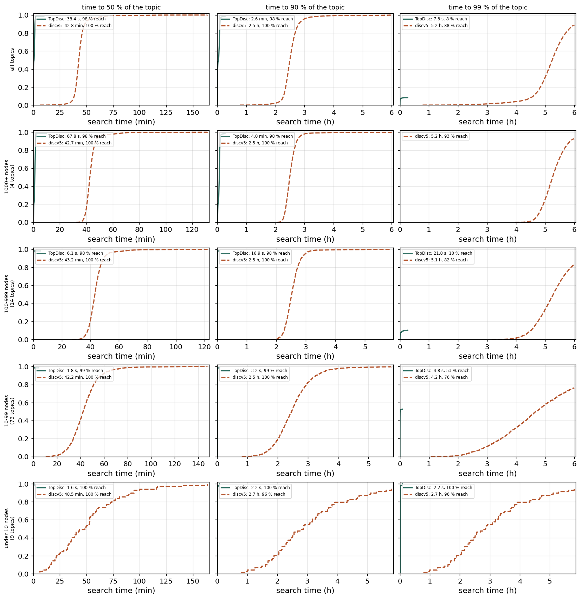

*Time for each searcher to find 50 %, 90 % and 99 % of its topic, by topic size. Searchers that never got there count in the denominator, so a curve ends at the share that did; the legend gives the median time of those that did.*

**Reading.** TopDisc takes 98 % of searchers to 90 % of their topic at a median 2.6 min, 3.2 s for topics of 10 to 99 nodes; discv5 needs 2.5 h. Only 8 % of TopDisc searchers reach 99 %, against 88 % for discv5.

### cp_09_discovery_rate

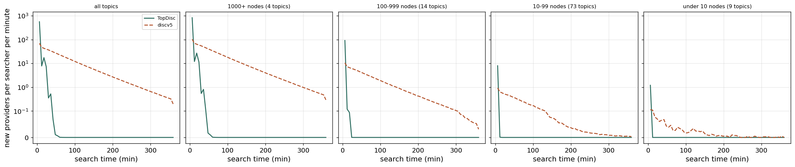

*New providers found per searcher per minute over the search, by topic size: how fast each protocol is still learning.*

**Reading.** TopDisc finds nearly all it will find within the first 20 to 60 min, then its rate drops to zero; discv5 keeps finding providers for 6 h. Discovery is front-loaded, but providers TopDisc missed are not found later.

### Time to the first provider

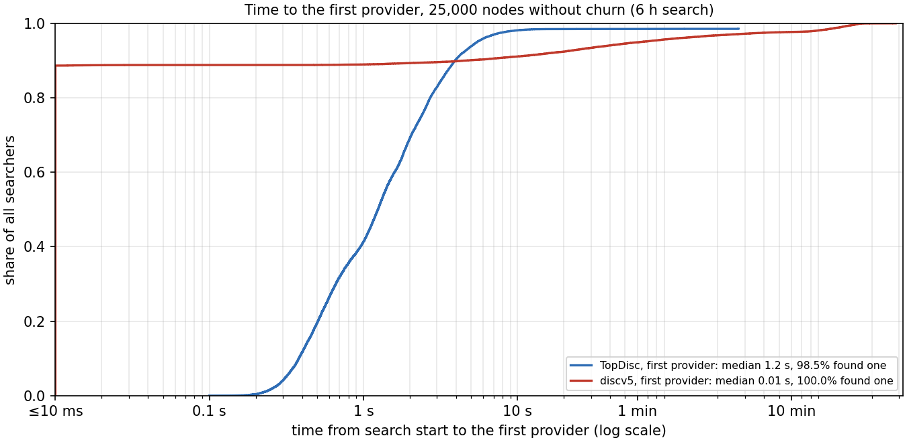

*Share of all searchers that had found a provider, against time since their search started, on a log time axis. discv5 starts high because 62 % of its searchers already had a provider in their routing table.*

**Reading.** 98.5 % of TopDisc searchers have a provider within about 10 s, median 1.2 s, and the curve is flat after that. discv5 starts higher from routing tables and reaches 100 %; the 1.5 % of TopDisc searchers without a provider never find one.


### cp_10_search_requests

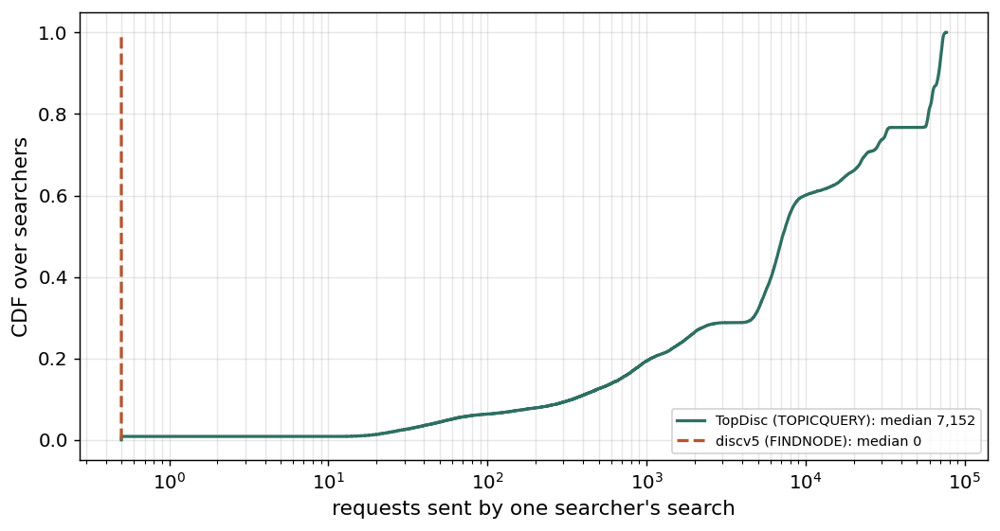

*Requests each searcher's own search sent: TOPICQUERY for TopDisc, FINDNODE for the plain walk (fork build).*

**Reading.** A TopDisc searcher sends a median 7,152 TOPICQUERY requests over 6 h, though new providers stop arriving within about an hour (cp_09). The discv5 curve reads 0 because its search requests were not counted, so there is no comparison.

### cp_12_idspace_found_share

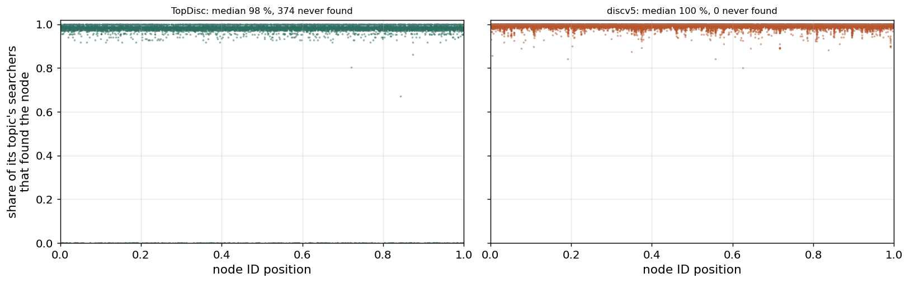

*For each provider, the share of the other searchers of its topic that found it, across the ID space.*

**Reading.** A median provider is found by 98 % of its topic's searchers with TopDisc and 100 % with discv5, evenly across the ID space. TopDisc left 374 providers unfound, against none for discv5.

### oh_06_idspace_found_time (TopDisc only)

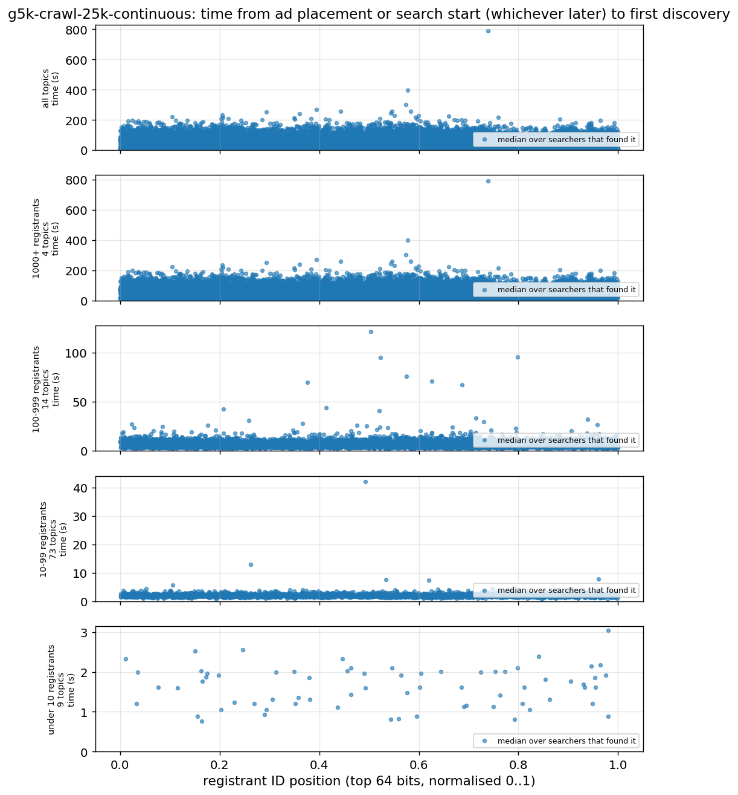

*Time from when an ad could first be found (placed, with searches running) to its first discovery, across the ID space.*

**Reading.** New ads are first found within about 200 s for the largest topics, 15 s for 100 to 999 nodes and 3 s for smaller topics, with no ID-space region left behind. Every placed ad is discovered quickly.


## 3. Overhead and load

### Load summary

| metric | TopDisc | discv5 |
|---|---:|---:|
| sent per node, whole run, p50 / p95 | 80 MB / 400 MB | – |
| requests served per node, whole run, p50 / max | 38,117 / 627,876 | – |
| reply bytes sent per node, whole run, p50 / max | 54 MB / 1463 MB | – |
| &nbsp;&nbsp;share of bytes sent: registration | 1.4 % | – |
| &nbsp;&nbsp;share of bytes sent: topic search | 74.5 % | – |
| &nbsp;&nbsp;share of bytes sent: DHT (FINDNODE/NODES) | 20.6 % | – |
| &nbsp;&nbsp;share of bytes sent: liveness (PING/PONG) | 1.4 % | – |
| &nbsp;&nbsp;share of bytes sent: session and other | 2.1 % | – |
| search phase: sent + received per node, mean | 257 MB | – |
| search phase: FINDNODE + TOPICQUERY sent per node, mean | 81,799 | – |
| search phase: bytes sent per provider found | 36.1 kB | – |
| search phase: requests per provider found | 22.9 | – |

### cp_13_idspace_traffic

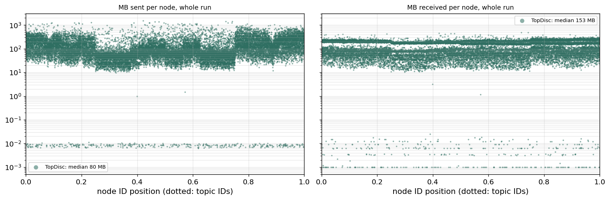

*Bytes each node sent and received over the whole run, against its position in the ID space.*

**Reading.** The median node sends 80 MB and receives 153 MB over the run. Nodes below 0.25 and above 0.75 in the ID space send several times more than those in the middle, so sending is uneven across the ID space.

### cp_14_msgtype

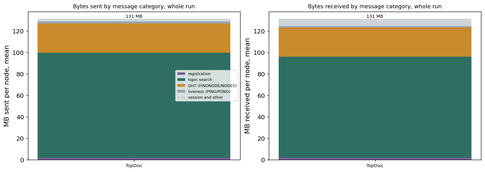

*Mean bytes per node by message category over the whole run: registration, topic search, DHT walk, liveness and session setup.*

**Reading.** A TopDisc node sends and receives a mean 131 MB over 6 h; topic search is about 98 MB of it and registration under 2 MB. Registration stays cheap; no discv5 bar is available for comparison.

### cp_04_traffic_over_time

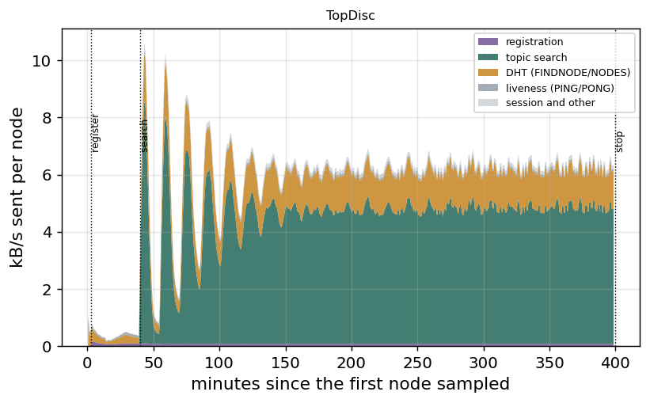

*Bytes sent per node per second, by message category, over the whole run; dotted lines mark the phases. Each panel has its own y scale.*

**Reading.** Topic search settles at about 5 kB/s per node for the whole 6 h, while registration stays near 0.1 kB/s. The search keeps querying at that rate long after new providers stop arriving (cp_09).

### cp_15_peak_rate_idspace

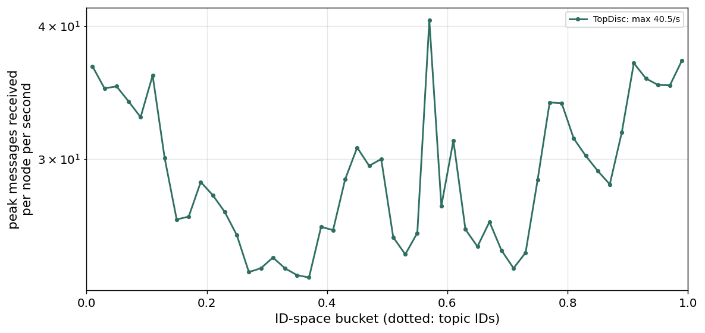

*Highest sustained receive rate per node (3-sample moving window) in each ID-space bucket, over the whole run.*

**Reading.** The highest sustained receive rate per node ranges from about 22 to 40.5 messages/s across the ID space. The 40.5/s peak in one bucket is about twice the quietest buckets, so peak load is uneven but bounded.

### cp_16_load_vs_topic_distance

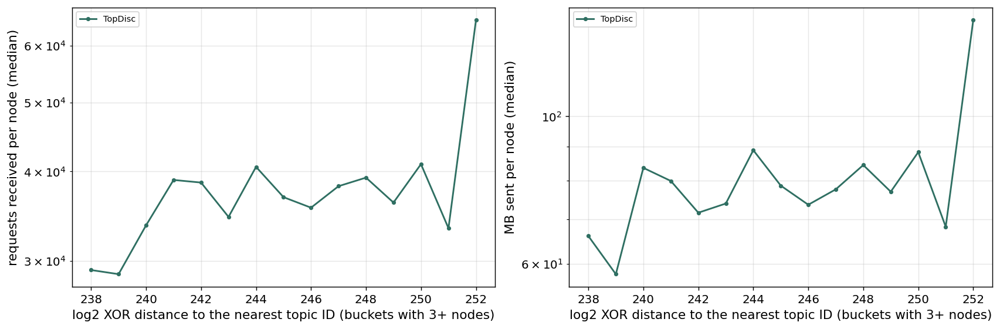

*Load against a node's distance to the closest topic ID. TopDisc concentrates registrations and queries near topic IDs; a plain walk does not depend on topics.*

**Reading.** Load does not rise toward topic IDs: nodes at log2 distance 238 to 239 receive about 29,000 requests, against 33,000 to 41,000 farther out. The closest nodes to a topic do not become hotspots.

### cp_17_cost_vs_topic_size

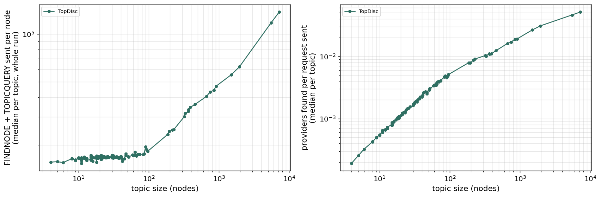

*Discovery requests each node sent over the whole run, and providers found per request, against the size of its topic. Whole-run counts include table upkeep and, for TopDisc, registration walks.*

**Reading.** Requests per node grow with topic size, from about 25,000 for small topics to about 127,000 for the largest, and providers found per request rise with it. Nodes of small topics still send about 25,000 requests, though their topics are found within seconds.

### cp_05_search_cost

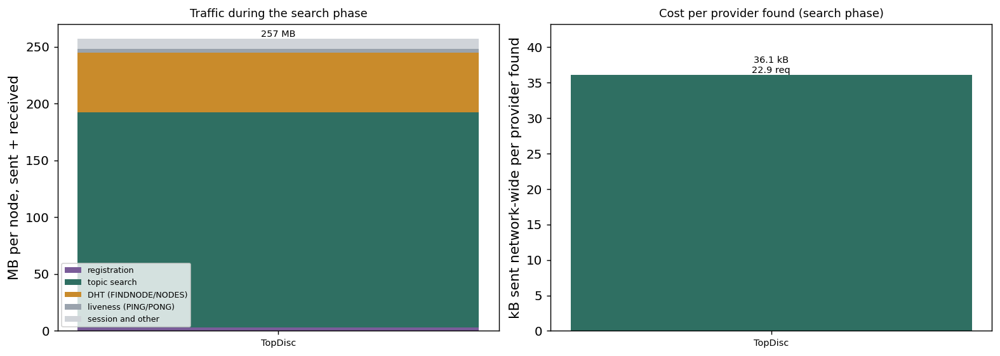

*Left: bytes each node sent and received while the searches ran, by category, averaged over all nodes. Right: bytes sent by the whole network during the search phase divided by the providers all searchers found, with the FINDNODE and TOPICQUERY requests per provider.*

**Reading.** During the search phase a node sends and receives a mean 257 MB, most of it topic search, and the network spends 36.1 kB and 22.9 requests per provider found. No discv5 counterpart is available.

### cp_06_serving_load

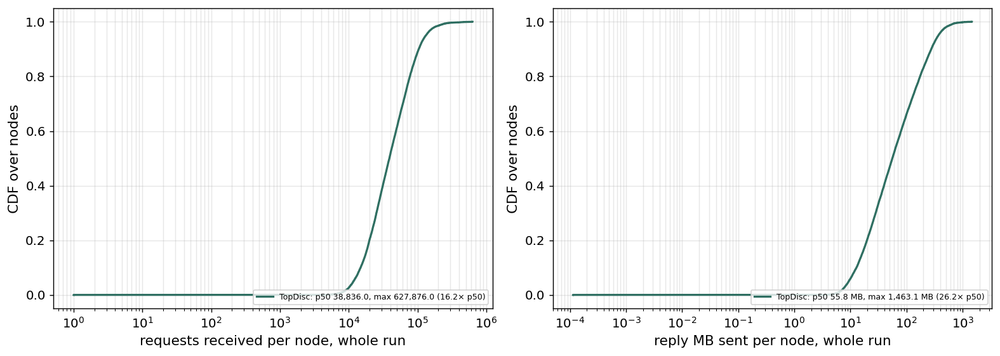

*Load each node carries for others over the whole run: requests received (FINDNODE, TOPICQUERY, REGTOPIC, PING) and bytes of the replies it sent (NODES, TOPICNODES, REGCONFIRMATION, PONG).*

**Reading.** The median node serves 38,836 requests and sends 55.8 MB of replies, with most nodes within one order of magnitude. The busiest serves 627,876 requests, 16.2 times the median, and sends 1,463 MB.

### oh_10_reg_vs_lookup (TopDisc only)

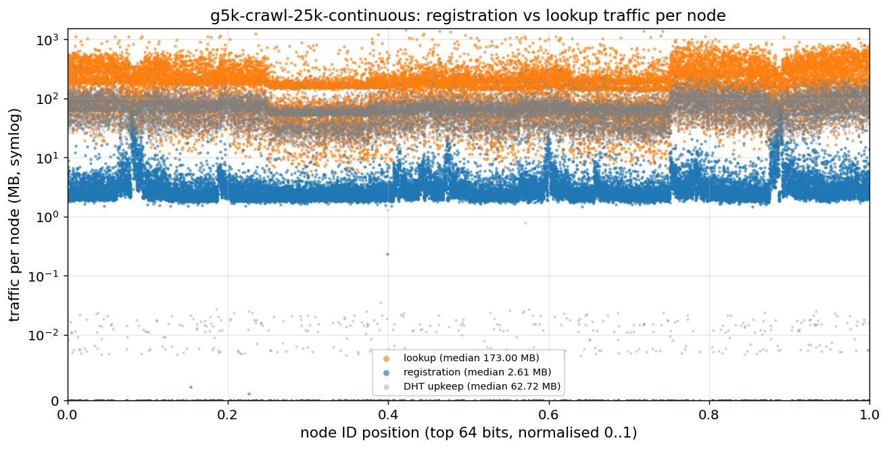

*Registration vs lookup traffic per node.*

**Reading.** Per node, lookup traffic has a median of 173 MB, DHT upkeep 62.7 MB and registration 2.6 MB, so registration is a small part of the cost. Registration traffic rises to about 50 MB near the two largest topic IDs.

### oh_11_topic_load (TopDisc only)

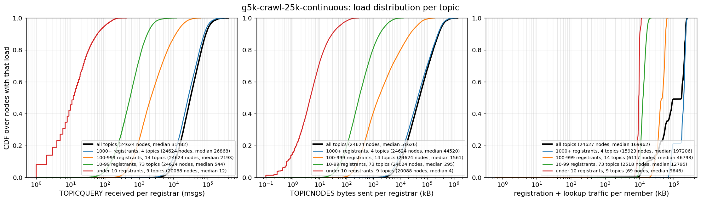

*Load distribution per topic: search requests (TOPICQUERY) received and TOPICNODES bytes sent per registrar, and registration and lookup traffic per member.*

**Reading.** Registrars receive a median 26,868 TOPICQUERY requests for the largest topics and 12 for topics under 10, so load follows topic size. The busiest registrar reaches 12.7 times the median, above the 10× bound (check A3 fails).

## 4. Run health

| metric | TopDisc | discv5 |
|---|---:|---:|
| node CPU, p95 / max | 3 % / 10 % | 7 % / 22 % |
| node RSS, p95 / max | 72 / 154 MB | 77 / 106 MB |
| UDP receive-buffer drops | 0 | 0 |

TopDisc:

```
hostmetrics: 40400 samples over 50 hosts; node cpu% p50=0 p95=2 max=9; rss MB p50=49 p95=71 max=153; no UDP receive-buffer drops
```

discv5:

```
hostmetrics: 38400 samples over 48 hosts; node cpu% p50=6 p95=7 max=22; rss MB p50=55 p95=76 max=106; no UDP receive-buffer drops
```

Every node runs plain discv5, so the TopDisc registration and topic-search figures are left out. `compare_protocols.py` puts this run next to its TopDisc pair.

## Not in this report

| item | reason |
|---|---|
| `cp_11_lookup_latency` | every searcher ran one long search (continuous or connection model); lookup latency applies to the scheduled model |
| `12_search_bucket (TopDisc only)` | not in the TopDisc per-run report |
| `12_search_bucket (TopDisc)` | not produced by figures.py (see gen.log) |

## Findings and fixes

The evaluation found these protocol problems. Each led to a change in the geth implementation and, where it changes behaviour, in the spec.

### Load concentration near the topic: adaptive search

The original search asked the registrars closest to the topic ID first and stayed there. On 858 real nodes the busiest registrar took 217,000 queries an hour, 25× the median. In the simulator the busiest-to-median ratio grew to 605× at 30,000 nodes and 19,099× at 250,000.

A topic search runs in **passes**. A pass builds a fresh search table from the node's routing table, sorted into 18 buckets by distance to the topic, and queries registrars one at a time, starting from the active bucket; it ends when that bucket is used up or after 32 queries. The next pass starts after a short gap and builds its table again.

The adaptive search ([#144](https://github.com/datahop/go-ethereum/pull/144)) moves the active bucket by the ad yield of recent replies: outward when replies are full, inward when they are empty, and it stays when they carry at least 8 ads. Each pass is capped at 32 queries, nodes asked in the last ad lifetime are not asked again, and the gap between passes that find nothing new grows from 2 s to 60 s. In the simulator the busiest-to-median ratio fell to 7.2× at 30,000 nodes and 33× at 250,000; the 25k AWS run with churn measured 10.2×.

### One registrar filling a reply: result filter and mixer

A single registrar could return all 16 results a searcher asked for. Sybil registrars answering only with sybil ads then eclipsed a share of searchers equal to the sybil share: 20.7 % at 20 % sybils, in the simulator at 30,000 nodes. Searches also returned the same registrants every pass.

The result filter suppresses a node already returned for one ad lifetime, and the mixer hands results out round-robin across at least 5 registrars, or after 5 s ([#140](https://github.com/datahop/go-ethereum/pull/140)). At 20 % sybils, full eclipse fell to 0.15 % of searchers. No rule helps when sybils are a majority of the registrars asked.

### Late ticket retries

Under churn, an advertiser's ticket retries queued behind first contacts to departed peers and reached registrars after the 5 s ticket window. Registrars dropped them without a reply, so advertisers took live registrars for dead ones and large topics were left with too few registrations to be found.

[#153](https://github.com/datahop/go-ethereum/pull/153) gives each topic 4 registration senders with ticket holders served first, and makes a registrar answer every REGTOPIC: a ticket up to 10 s late is credited, an early one is echoed back, and an invalid, expired or reused one starts a new attempt.

### Re-asking unreachable peers

Searches asked the same unreachable table entries again on every pass, and registrations retried them on every round of their registration loop. [#151](https://github.com/datahop/go-ethereum/pull/151) keeps a failed peer out for one ad lifetime, per search and per registration.

### Tickets

A ticket is the registrar's receipt for the time an advertiser has already waited, so the advertiser can come back later and be credited that wait instead of starting over. The registrar keeps no state for it: the ticket travels with the advertiser and is sealed with an HMAC under a key only the registrar holds, rotated every 6 h or 100,000 tickets.

A sealed ticket carries the topic, the advertiser's node ID, the wait it was quoted, when it was last used and when the waiting started. When an advertiser returns, the registrar checks the MAC, then compares the ticket's node ID with the node ID of the discv5 session the REGTOPIC arrived on. That ID comes from the session's handshake, which proves the sender holds the node's private key. A ticket presented by any other node is answered as a new attempt and stays redeemable by its owner ([#160](https://github.com/datahop/go-ethereum/pull/160), which fixed [#68](https://github.com/datahop/go-ethereum/issues/68): before it, tickets named only the topic and any node could use another's).

A ticket is valid in a 5 s window starting when its quoted wait ends, and is credited up to 10 s late. It is also single use: the registrar remembers each redeemed ticket by its MAC for the length of the window plus the grace, so the same ticket cannot be replayed within its window ([#153](https://github.com/datahop/go-ethereum/pull/153), which fixed [#69](https://github.com/datahop/go-ethereum/issues/69)).

### Other fixes

| Problem | Fix |
|---|---|
| Recall stalled near 20 % as the closest registrars locked in | waiting-time lower bound, [#105](https://github.com/datahop/go-ethereum/pull/105) |
| Wait-time overflow at high occupancy admitted every ad on amd64 | 24 h cap, [#155](https://github.com/datahop/go-ethereum/pull/155) |
| Advertisers dropped registrars that quoted under 1 s | clamp to 1 s, [#157](https://github.com/datahop/go-ethereum/pull/157) |
| Registration buckets mislabelled: the 4 closest held 2.8, 1.0, 0.4 and 0 of 5 | label bucket i as distance 256−i, [#145](https://github.com/datahop/go-ethereum/pull/145) |
| IPv4 and IPv6 scored on different scales | normalise by effective depth, [#84](https://github.com/datahop/go-ethereum/pull/84) |
| Ads could point at a third party's address | record IP must equal the packet source, [#107](https://github.com/datahop/go-ethereum/pull/107) |
| Ad cache jammed under sustained load | keep the cache ordered by expiry, [#99](https://github.com/datahop/go-ethereum/pull/99) |
| IP tracker counters drifted under churn | remove IPs only to their inserted depth, [#159](https://github.com/datahop/go-ethereum/pull/159) |

### Spec status

The behaviour changes above are written into the spec amendments in datahop/devp2p: [#15](https://github.com/datahop/devp2p/pull/15) (merged into #13's branch) → [#13](https://github.com/datahop/devp2p/pull/13) → [#11](https://github.com/datahop/devp2p/pull/11) (into `master`). The wait-time lower bound is already in `master`. Still to add:

1. The ticket binding to the advertiser's node ID (#160); the spec's ticket-transfer text is stale.
2. The spec asks tickets to bind an `adDigest` (record and payload); the code binds node ID and topic only.
3. Rate limiting of empty-ticket REGTOPIC ([#63](https://github.com/datahop/go-ethereum/issues/63)).
4. Final values for `C`, `G`, `K_register` and `F_return` ([#12](https://github.com/datahop/go-ethereum/issues/12)).
