# Grid'5000 run: 25 000 TopDisc nodes, 6 h (2026-10-06)

Run `g5k-crawl-25k-6h-realip-20261006-210724`, fork `v1.17.2-testbed.14`, testbed `dda65fd8+dirty` (the state of PR #41 and #42 before they were merged). The run directory is on the Grid'5000 coordinator and on the maintainer's machine (17 GB, traces included). This page is the testbed's per-run report (`figures/report_run.py`) with its long tables cut, plus three load-balance figures and the conclusions.

## Summary

| | |
|---|---|
| backend | Grid'5000 Nancy, cluster `gros`: 50 machines, 500 TopDisc nodes each |
| population | 25 000 nodes, the 100 largest chains of the 2026-09-18 crawl as topics, node addresses from the crawl |
| search | connection model: each node searches its own topic until its 16 outbound peer slots are full, for 6 h |
| fork | `v1.17.2-testbed.14`; search floor 4 (not the selected 8), aux radius 1 |
| collected | 24 870 of 25 000 traces; 0 UDP drops; node CPU at most 9 %; at least 63 GB free per machine |

- **Search:** the median searcher found its first provider after 1.1 to 1.4 s and filled its peer slots after 1.6 to 2.0 s, at every topic size. No search reached the timeout.
- **Registration:** every ad was placed. The median ad was held by 41 registrars (topics of 1 000+ nodes) to 47 registrars (topics of 10 to 99 nodes).
- **Load:** a node received 3 212 requests in 6 h 40 min at the median (about 480 per hour) and moved 16.6 MB (about 5.5 kbit/s).
- **Load balance:** the busiest 1 % of the nodes received 10 % of the requests and the busiest 10 % received 37 %. The busiest node received 150 394 requests, 47 times the median, mostly REGTOPIC and FINDNODE. The busiest nodes are early-started nodes (index under 200) and nodes near the hashes of the two largest topics (ID positions 0.08 and 0.88 in figure `oh_01`).
- **Nodes 1 800 to 4 200** received about three times the median load (9 344 requests). They do not share a machine or a topic. This run does not show the cause.
- **358 nodes (1.4 %)** never connected and sent almost no traffic: index 18 090 to 24 951, spread over all machines. They are counted in the searcher tables as searchers with no provider.
- **Topics of 10 to 99 nodes:** 30 % of their searchers did not fill 16 outbound slots, because the topic has fewer reachable members than slots.

Points to check before the next Grid'5000 run:

1. The scenario sets search floor 4. The values selected for go-ethereum are floor 8 and aux radius 1.
2. Every node has an empty region label (`placement.json`), so this data does not show whether the latency model per region was applied.
3. Outbound connections per node: median 20 and p95 32, above the 16 outbound slots of the connection model.
4. 358 nodes never joined.

The figures `lb_01` to `lb_03` were added for this page. All other sections and figures come from the testbed's `report_run.py`, `figures.py` and `figures_overhead.py`.

## Conclusions

1. TopDisc runs at 25 000 real node processes on 50 machines with no packet drops, node CPU at most 9 % and 46 MB of memory per node.
2. A node gets its peers fast at every topic size: the first provider after 1.1 to 1.4 s at the median, 16 providers after 1.4 to 2.0 s. Every searcher of a topic with up to 16 started members found all of them.
3. Registration works at this scale: every started node's ad sits on 41 to 47 registrars.
4. The load is low: a node received 3 212 requests in 6 h 40 min at the median, about 480 per hour, and moved 16.6 MB, about 5.5 kbit/s. TOPICQUERY is the smallest of the three request types a node receives.
5. The load is uneven at the top: the busiest 1 % of nodes receive 10 % of the requests and the busiest 10 % receive 37 %. The busiest node received 150 394 requests, 47 times the median, mostly REGTOPIC and FINDNODE. The busiest nodes are the early-started ones (index under 200) and the nodes near the hashes of the two largest topics.
6. A search keeps querying after its consumer stops reading. Under the connection model a node stops taking providers once its 16 peer slots are full, after about 2 s, but its search goes on: 80 % of all TOPICQUERY traffic (37 of 47 million) was sent in the first 8 minutes of the search phase, and about one query per node per minute followed for 6 h. Almost all of it served nobody. This is a go-ethereum change: pause the search while results wait unread.

## Gaps: what this run does not show

1. **Total recall:** The connection model stops a searcher at its 16 slots, so recall measures how many peers a node needed, not how many the search could reach. Topics above 16 members cannot reach full recall by design. The scenario `g5k-crawl-25k-2h-continuous` runs the same network with the continuous search model to measure it.
2. **358 nodes never joined** (1.4 %): zero connections, about 0.01 MB of traffic, almost no placed ads. They are the last-started nodes (index 18 090 to 24 951), with the failure rate rising to 10 % of the last 1 000, spread over all 50 machines and not clustered in any /24. The bootnode's own trace (node 0) is among the 130 traces that returned 404 at collection, so a bootnode that died or stalled during the start window is the lead. The node logs on the machines have not been checked. The tables above count these nodes as searchers with no provider and as registrants never found; counting only started nodes, every searcher of a topic with up to 16 members found all of them, 68 % of searchers of 17 to 39 members did, and only 4 of 24 512 started registrants were never found by anyone.
3. **Search settings:** The run used a search floor of 4; the value selected for go-ethereum is 8 (aux radius 1 in both). The pass budget, the direction rule for fallback replies and the asked filter for failed nodes landed in go-ethereum after this run; the fork tag testbed.14 has none of them.
4. **No regional latency:** Every node has an empty region in `placement.json`: the Grid'5000 inventory has no regions, so the scenario's per-region RTT table was not used. The WAN model gave every link 4 to 45 ms with 3 ms jitter and a 1 Mbit/s cap.
5. **Outbound peers above the limit:** The connection model allows 16 outbound slots, but the traces report 20 at the median and 32 at the p95. Either the count includes connections the dialer did not open, or the limit is not enforced on the real backend. Not explained.
6. **130 traces missing** (0.5 %), node 0 among them, so the bootnode's load and the aggregates miss those nodes.
7. **No churn and no plain-discv5 counterpart on this backend yet:** The simnet comparison is in `topdisc-vs-discv5.md`; the Grid'5000 scenarios `g5k-crawl-25k-churn` and `g5k-crawl-25k-legacy` have not run.
8. **Load balance is not a testbed figure:** The three `lb_` figures below were drawn for this page from `oh.json` and `metrics.json`; the testbed's figure set has no per-node load distribution or busiest-share figure.

## Scenario

25000 nodes, 100 topics (Zipf s=1.07), search model `conn`, no churn.

Run directory: `g5k-crawl-25k-6h-realip-20261006-210724` (Grid'5000 Nancy, cluster `gros`, 50 machines with 500 nodes each, 2026-10-06 21:07 UTC, 6 h 40 min).

### Parameters

| parameter | value |
|---|---|
| `backend` | cloud |
| `nodes` | 25000 |
| `topics` | 100 |
| `zipf_s` | 1.07 |
| `legacy_frac` | 0 |
| `seed` | 1 |
| … | (37 rows, in the run directory) |

### Topic assignment

| topic | nodes | share |
|---:|---:|---:|
| 0 | 7152 | 28.8% |
| 1 | 5480 | 22.0% |
| 2 | 1945 | 7.8% |
| 3 | 1488 | 6.0% |
| 4 | 900 | 3.6% |
| 5 | 738 | 3.0% |
| … | (100 rows, in the run directory) | |

## Correctness checks

Functional assertions over the run's traces (`checks.py`, verdicts and evidence in `checks.json`). *not-exercised*: the run never reached the condition; *needs-data*: the traces lack a field the check needs.

14 needs-data, 8 not-exercised, 7 pass, 2 fail, 1 unit-test.

| check | assertion | status | evidence |
|---|---|---|---|
| **C1** registration | capacity: ads held never exceed the cache size | pass | network-wide peak 1048624 of 9765000 (per-node maxima not in simnet series) |
| **C2** registration | no duplicates: one ad per advertiser and topic per registrar | needs-data | no per-registrar ad sets (simnet: ads.json) |
| **C3** registration | only registrants: every held ad is from a node registering that topic | needs-data | no per-registrar ad sets (simnet: ads.json) |
| **C4** registration | only capable nodes: no legacy node in any cache | not-exercised | no legacy nodes in the run |
| **C5** registration | no self-ads: a registrar never holds its own ad | needs-data | no per-registrar ad sets (simnet: ads.json) |
| **K1** registration | departed nodes leave caches within an ad lifetime | not-exercised | no churn in the run |
| … | (32 rows, in the run directory) | | |

## 1. Registration and cache

### Registration coverage after the register-wait phase

*(100 lines of run log, in the run directory.)*

### Registration latency

*(101 lines of run log, in the run directory.)*

### 06_fanout_both_views

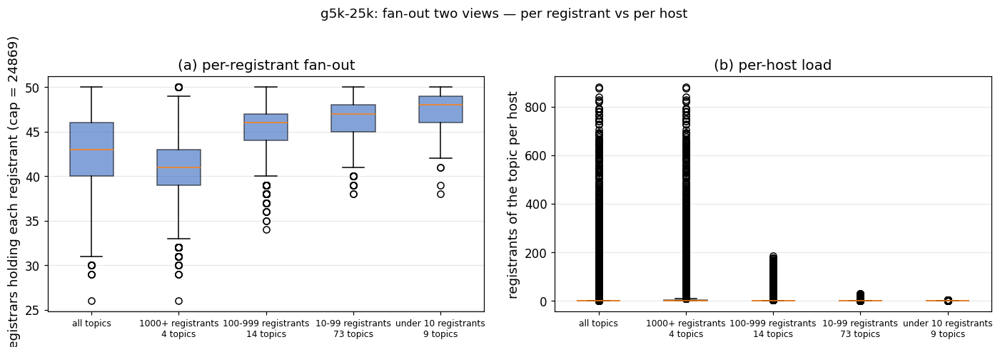

*(a) Registrars holding each registrant's ad; (b) ads held per registrar.*

### 04_id_space_registrants

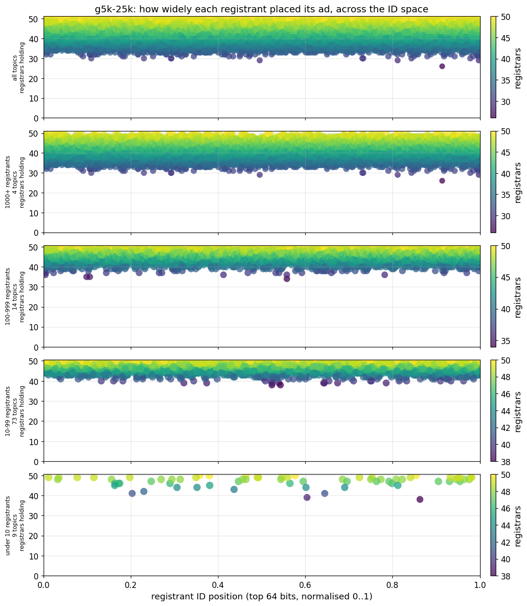

*Fan-out of each registrant across the ID space.*

### 04b_id_space_registrars

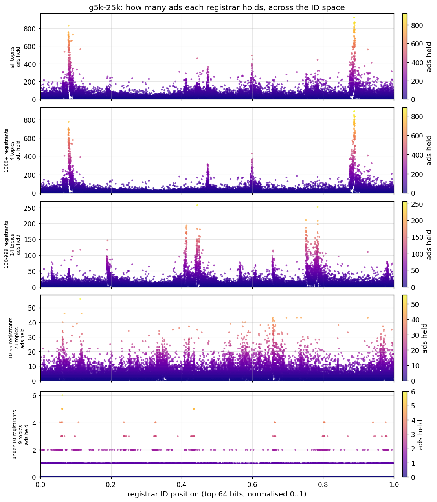

*Ads held by each registrar across the ID space.*

### 07_registration_latency_bar

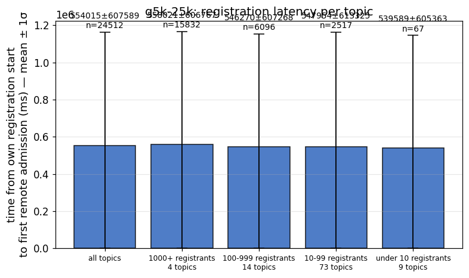

*Mean ± 1σ time to first remote admission per topic.*

### 07_placement_time_idspace

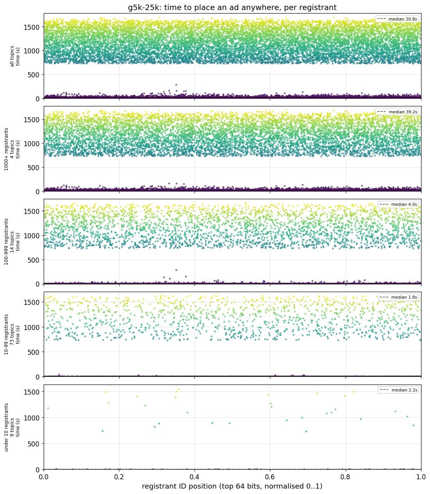

*Time to first admission across the ID space (earliest registrar).*

### oh_05_wait_time_cdf

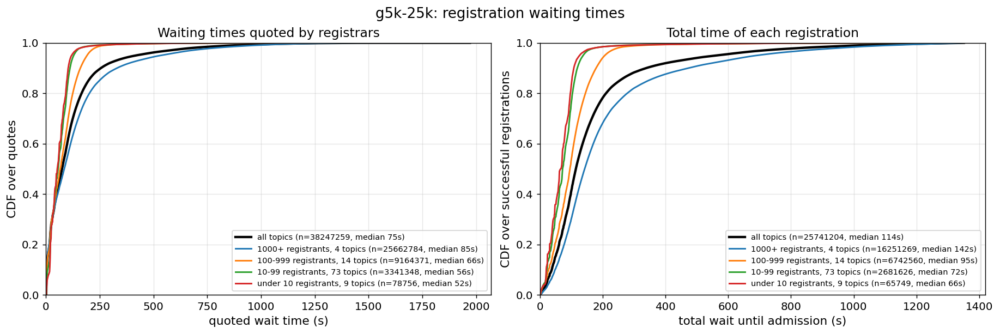

*(a) Waiting times quoted by registrars; (b) total time of every successful registration, from its first REGTOPIC to admission.*

### oh_08_cache_utilisation

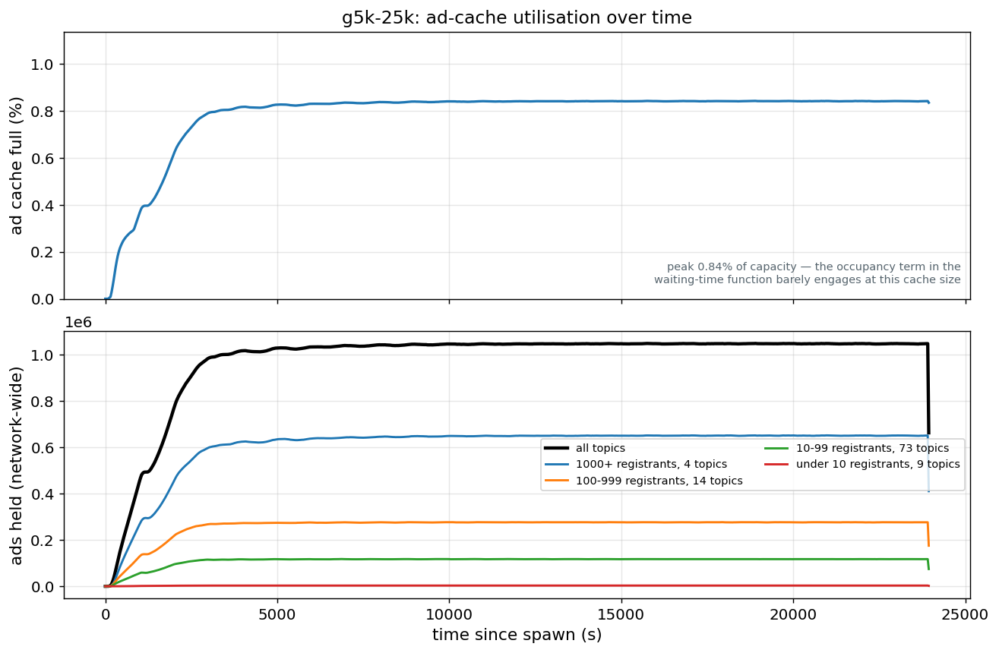

*Ads held network-wide and per topic against cache capacity, over time.*

## 2. Discovery

### Per-topic search results

*(101 lines of run log, in the run directory.)*

### How many searchers found each registrant

*(101 lines of run log, in the run directory.)*

### Final coverage

*(100 lines of run log, in the run directory.)*

### Search progress

Median per search over the run; `filtered` counts results dropped as recently returned.

| topic | searches | passes | queries | contacted | received | duplicate | filtered | yielded | filtered / received |
|---:|---:|---:|---:|---:|---:|---:|---:|---:|---:|
| 0 | 7037 | 1 | 1408 | 1355 | 11933 | 5752 | 387 | 229 | 3% |
| 1 | 5405 | 1 | 1107 | 1074 | 9440 | 4531 | 396 | 229 | 4% |
| 2 | 1919 | 1 | 435 | 428 | 3685 | 1553 | 424 | 226 | 12% |
| 3 | 1471 | 1 | 363 | 362 | 3154 | 1327 | 454 | 224 | 14% |
| 4 | 887 | 1 | 356 | 353 | 3143 | 1434 | 761 | 225 | 24% |
| 5 | 727 | 1 | 309 | 308 | 2704 | 1121 | 782 | 226 | 29% |
| … | (100 rows, in the run directory) | | | | | | | | |

> **Search re-walk:** on topic(s) 0, 1, 2, 3, 4, 5, 6, 7, 8, 9, 10, 11, 12, 13, 14, 15, 16, 17, 18, 19, 20, 21, 22, 23, 24, 25, 26, 27, 28, 29, 30, 31, 32, 33, 34, 35, 36, 37, 38, 39, 40, 41, 42, 43, 44, 45, 46, 47, 48, 49, 50, 51, 52, 53, 54, 55, 56, 57, 58, 59, 60, 61, 62, 63, 64, 65, 66, 67, 68, 69, 70, 71, 72, 73, 74, 75, 76, 77, 78, 79, 80, 81, 82, 83, 84, 85, 86, 87, 88, 89, 90, 91, 92, 93, 94, 95, 96, 97, 98, 99 searches dropped more results as recently returned than they handed out: with no new registrants left they re-walk their tables every pass (datahop/go-ethereum#142). Query traffic and registrar load on these topics measure that loop.

### 02_recall_reached

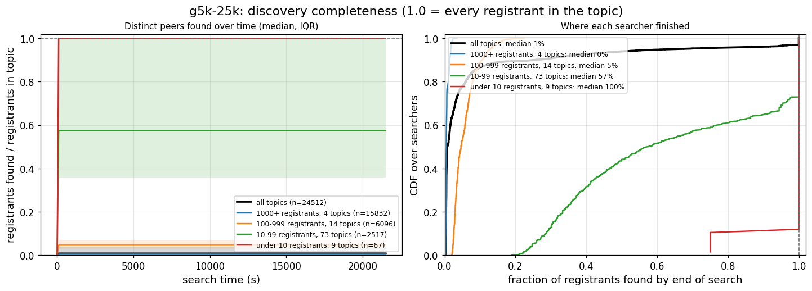

*Distinct registrants found over time and where each searcher finished (1.0 = every registrant of its topic).*

### 03_time_to_fraction

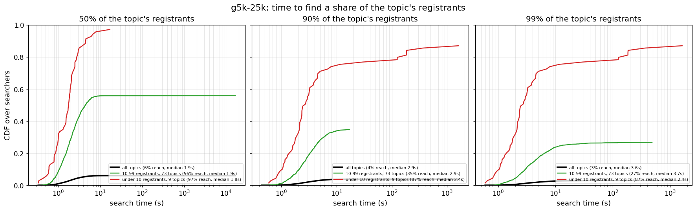

*Time for each searcher to find 50%, 90% and 99% of its topic's registrants.*

### 11_discovery_rate

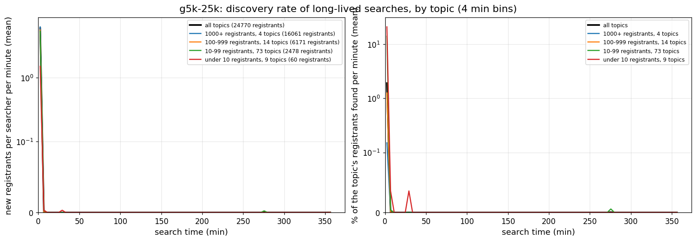

*Discovery rate of long-lived searches (continuous, conn): new registrants per searcher per minute, absolute and as a share of the topic.*

### 02b_time_to_first_cdf

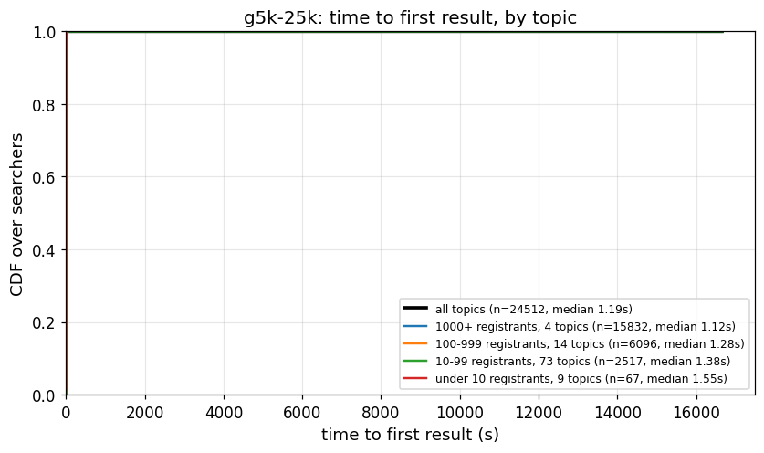

*CDF of time to the first result, per topic, net of the node's scheduled absences when the run wrote churn.json.*

### 08_lookup_latency_cdf

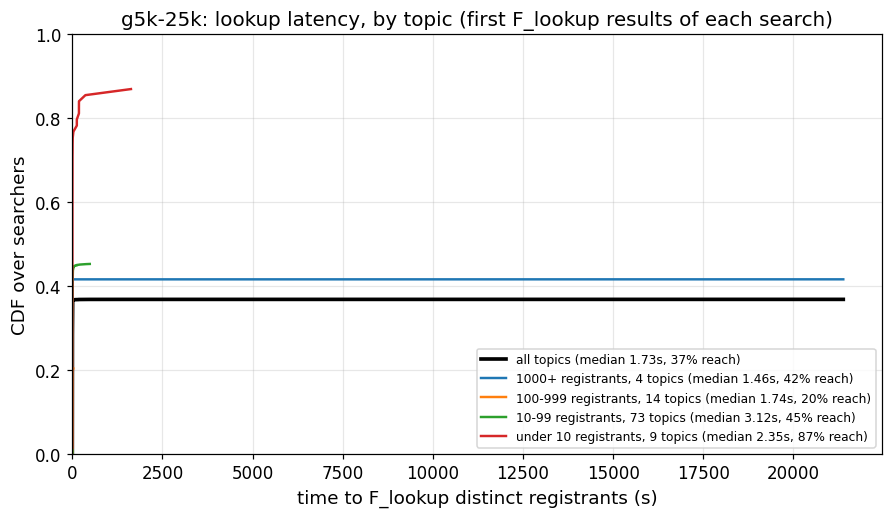

*Lookup latency: time to reach F_lookup distinct registrants, per topic.*

### 05_id_space_found_vs_missed

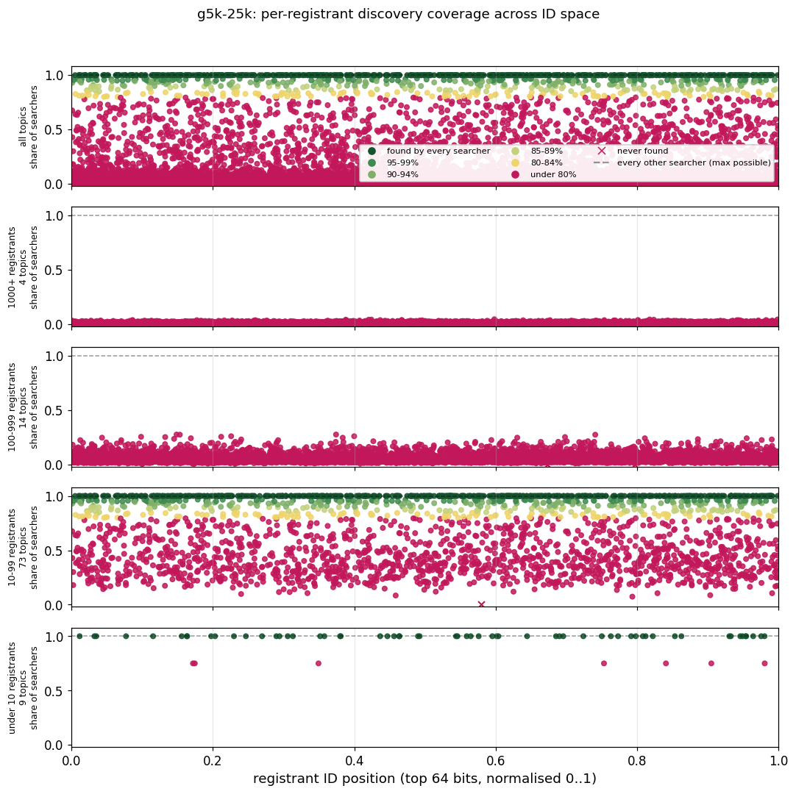

*Share of the other searchers that returned each registrant, across the ID space; registrants online for less than an ad lifetime are hollow.*

### oh_06_idspace_found_time

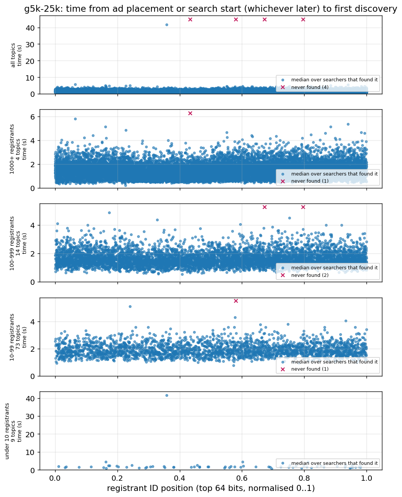

*Time from when an ad could first be found (placed, with searches running) to its first discovery, across the ID space.*

## 3. Overhead and load

### oh_01_idspace_traffic

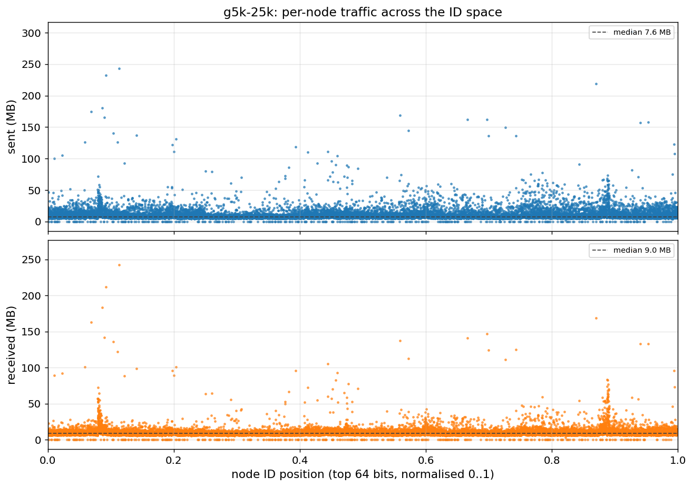

*Messages and bytes sent and received per node, across the ID space.*

### oh_03_idspace_msgtype

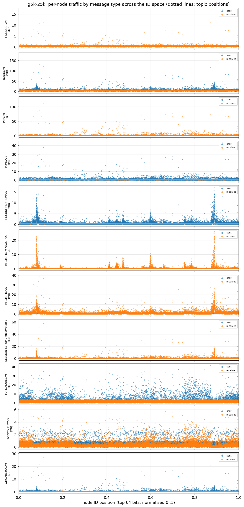

*Per-node traffic by message type, across the ID space.*

### oh_10_reg_vs_lookup

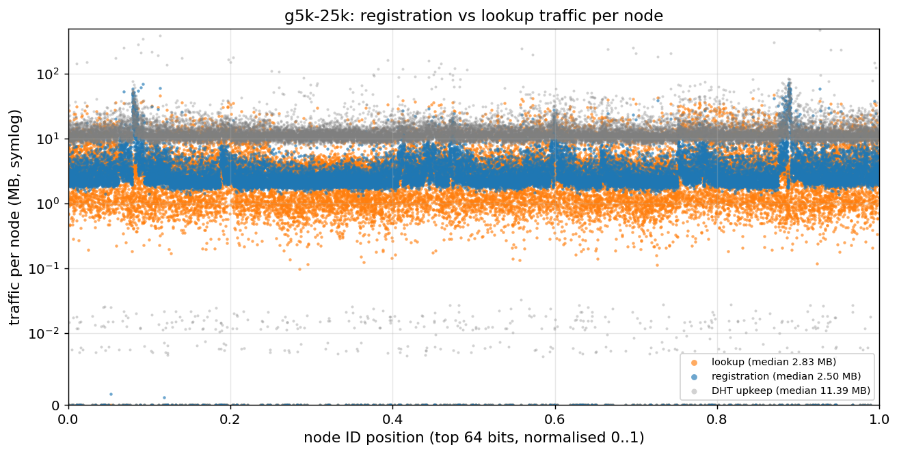

*Registration vs lookup traffic per node.*

### oh_02_idspace_peak_rate

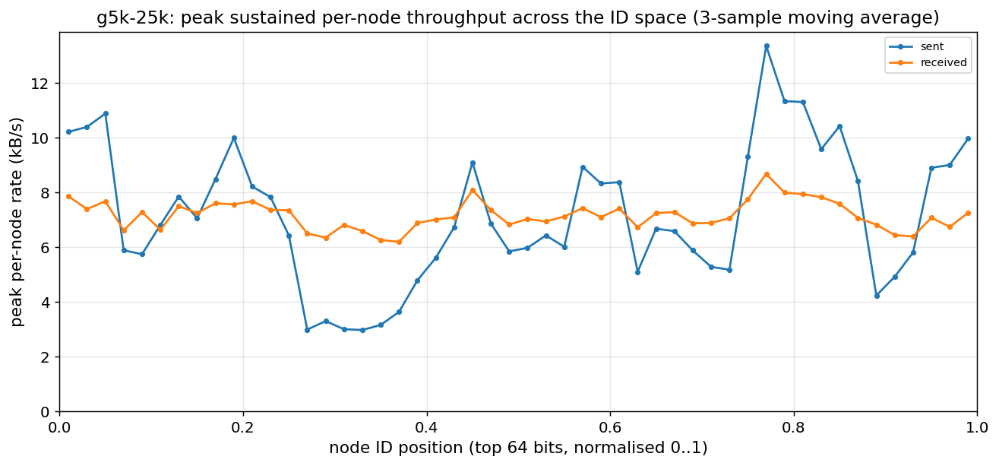

*Peak sustained per-node rate, across the ID space.*

### oh_04_idspace_peak_msgtype

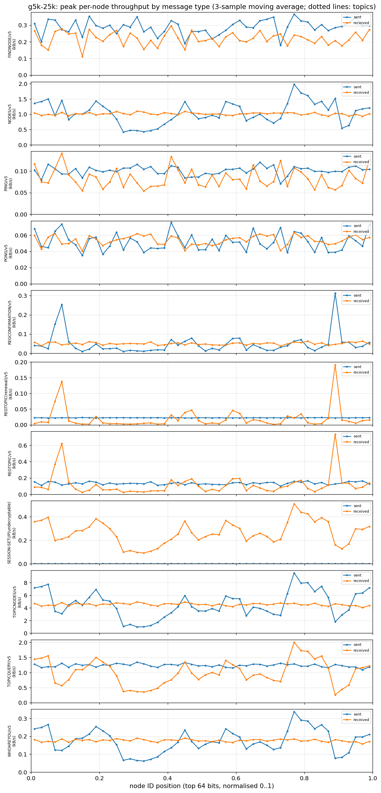

*Peak sustained per-node rate by message type.*

### oh_07_load_vs_topic_distance

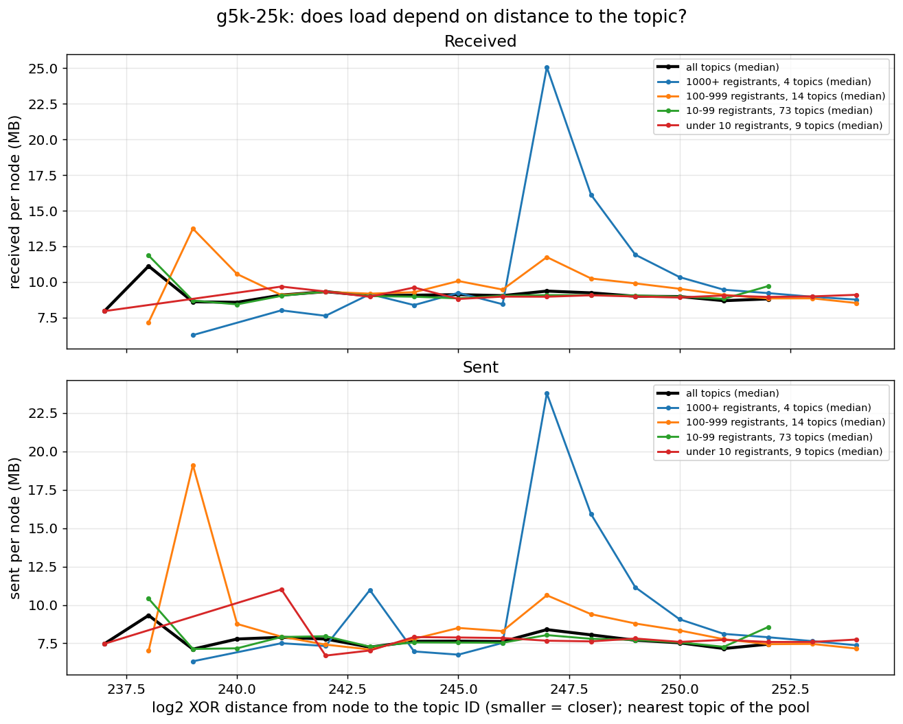

*Median received and sent traffic per node against XOR distance to each topic.*

### oh_09_cost_per_lookup

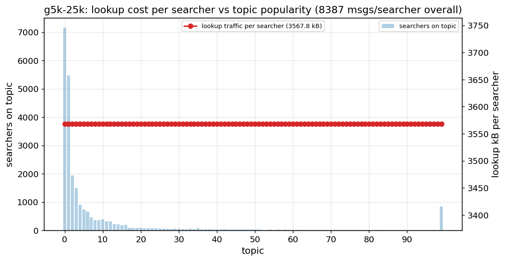

*Lookup traffic per searcher against topic size.*

### oh_11_topic_load

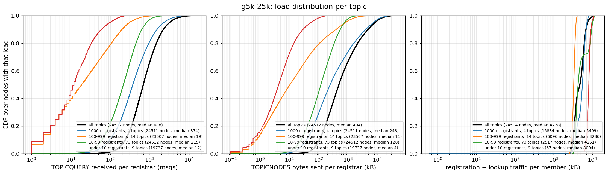

*Load distribution per topic: search requests (TOPICQUERY) received and TOPICNODES bytes sent per registrar, and registration and lookup traffic per member.*

### Load summary

| load | topic | unit | nodes | median | p95 | p99 | max | CV |
|---|---:|---|---:|---:|---:|---:|---:|---:|
| TOPICQUERY received per registrar | all topics | msgs | 24870 | 677.0 | 3170.5 | 6159.9 | 16619.0 | 1.15 |
| TOPICQUERY received per registrar | 1000+ registrants, 4 topics | msgs | 24870 | 367.0 | 2274.0 | 4560.5 | 12465.0 | 1.34 |
| TOPICQUERY received per registrar | 100-999 registrants, 14 topics | msgs | 24870 | 16.0 | 298.0 | 644.3 | 1750.0 | 1.99 |
| TOPICQUERY received per registrar | 10-99 registrants, 73 topics | msgs | 24870 | 212.0 | 834.0 | 1412.0 | 6301.0 | 1.04 |
| TOPICQUERY received per registrar | under 10 registrants, 9 topics | msgs | 24870 | 8.0 | 84.0 | 170.3 | 484.0 | 1.73 |
| TOPICQUERY received per registrar | 0 | msgs | 24870 | 139.0 | 1575.5 | 3549.6 | 11991.0 | 1.81 |
| … | (316 rows, in the run directory) | | | | | | | |

## Load balance

### lb_03_first_provider_and_slots

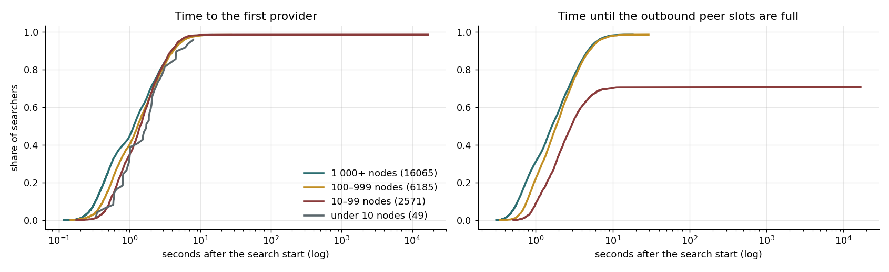

*Time to the first provider and time until the 16 outbound slots are full, per topic size, on a log scale. The curves end below 1 for searchers that did not finish: the 358 nodes that never joined, and searchers of small topics that cannot fill 16 slots.*

### lb_01_load_per_node

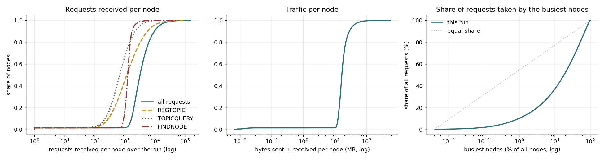

*Left: requests received per node over the run, in total and per type. Middle: bytes sent and received per node. Right: the share of all requests received by the busiest nodes; the dotted line is an equal share.*

| | median | p99 | max |
|---|---:|---:|---:|
| requests received per node | 3 212 | 31 408 | 150 394 |
| REGTOPIC received | 1 162 | 24 396 | 99 502 |
| FINDNODE received | 1 259 | 3 371 | 58 968 |
| TOPICQUERY received | 677 | 6 160 | 16 619 |
| bytes sent and received per node | 16.6 MB | 71.7 MB | 565 MB |

### lb_02_load_by_start_order

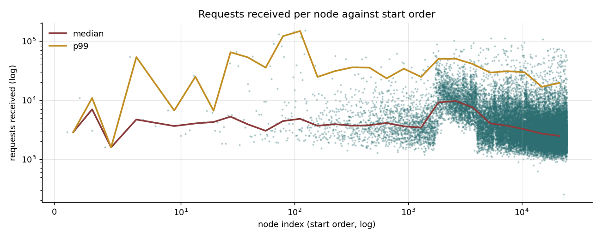

*Requests received per node against its index, which is its start order. Lines: median and p99 per index range.*

Nodes with index under 200 have the highest p99 (up to 150 000 requests): they started first and are in many routing tables. Nodes 1 800 to 4 200 have a median of 9 344 requests, against 2 915 for nodes from 4 200 up.

## 4. Run health

```
hostmetrics: 40350 samples over 50 hosts; node cpu% p50=0 p95=0 max=9; rss MB p50=46 p95=64 max=140; no UDP receive-buffer drops
```

## Not in this report

| item | reason |
|---|---|
| `12_search_bucket` | not produced by figures.py (see gen.log) |
| `09_lookup_contacts_cdf` | not produced by figures.py (see gen.log) |